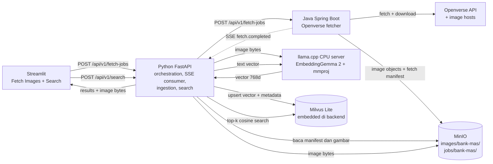

# Bank MAS Image Search

Mini image search untuk take-home assignment Machine Learning Engineer Bank MAS. Sistem mengambil gambar dari Openverse, menyimpannya di MinIO, membuat image embedding dari piksel gambar dengan EmbeddingGemma 2 melalui llama.cpp, menyimpan vector dan metadata di Milvus Lite, lalu menyediakan pencarian natural-language melalui Streamlit.

Dokumen kontrak dan keputusan desain ada di [docs/rencana-implementasi.md](docs/rencana-implementasi.md) dan [docs/api-spec.md](docs/api-spec.md). README ini fokus pada cara menjalankan stack secara lokal dan batasannya.

> **Status jujur:** branch `feature/deployment-tooling` hanya berisi deployment, script operasional, dan dokumentasi. Source `fetcher/`, `backend/`, dan `frontend/` dikerjakan di branch lain dan belum tersedia saat Containerfile ini ditulis. Karena itu image belum pernah di-build dan stack belum pernah dijalankan end-to-end. Validasi yang benar-benar dilakukan tercatat di bagian [Validasi](#validasi). Tidak ada screenshot, jumlah gambar, metrik retrieval, atau klaim performa di README ini.

## Arsitektur



Prinsip utama:

- Pencarian hanya memakai vector dari piksel gambar dan query user. Title, tags, dan nama kelas Openverse hanya berada di `evaluation_metadata` dan tidak dipakai untuk embedding, filter, ranking, atau reranking.
- Java hanya menangani Openverse, download, MinIO, job fetching, manifest, dan SSE.
- Python menangani API, SSE consumer, ingestion, Milvus, search, dan streaming gambar.
- llama.cpp hanya inference service; tidak mengakses MinIO atau Milvus.
- Milvus Lite berjalan di dalam proses backend, sehingga tidak ada service Milvus, etcd, PostgreSQL, Redis, atau RabbitMQ.

## Komponen dan port

| Service | Image / build | Port host (default) | Fungsi |
|---|---|---|---|
| `minio` | `bitnamilegacy/minio:2025.7.23-debian-12-r5` | `127.0.0.1:9000`, console `9001` | Object storage |
| `minio-init` | `bitnamilegacy/minio-client:2025.7.21-debian-12-r3` | - | Membuat bucket secara idempotent |
| `llama-embeddings` | `ghcr.io/ggml-org/llama.cpp:server-b12429` | `127.0.0.1:8080` | Embedding text + image |
| `fetcher` | `deploy/Containerfile.fetcher` | `127.0.0.1:8081` | Java fetcher + SSE server |
| `backend` | `deploy/Containerfile.backend` | `127.0.0.1:8000` | FastAPI + Milvus Lite |
| `frontend` | `deploy/Containerfile.frontend` | `127.0.0.1:8501` | Streamlit, dua halaman |

Semua port di-bind ke localhost secara default. Ubah `BIND_ADDRESS` di `.env` hanya jika memang perlu mengakses dari mesin lain.

## Prerequisites (fresh machine)

- Podman 5.x dan Podman Compose (plugin/provider `podman compose`, atau `podman-compose` 1.x).
- `curl` untuk mengunduh model.
- Python 3.10+ di host, hanya untuk menjalankan smoke test (script memakai standard library).
- Ruang disk minimal sekitar 5 GB untuk image container, model (~730 MB), dan data.
- RAM 8 GB bisa dicoba dengan concurrency rendah; 16 GB lebih nyaman. Ini pedoman, bukan hasil benchmark.
- Tidak perlu GPU, Docker Desktop, Java, Maven, atau `uv` di host. Build Java dan Python dilakukan di container.
- macOS: jalankan `podman machine init && podman machine start` sekali, lalu pastikan `podman compose version` bekerja.
- Linux dengan SELinux: jika model atau volume gagal dibaca, tambahkan `:z` pada mount model di `deploy/compose.yaml`.

Cek cepat:

```bash
podman --version
podman compose version
curl --version
```

## Setup

### 1. Clone dan environment

```bash
cp .env.example .env
```

Nilai di `.env.example` adalah placeholder lokal yang aman, bukan credentials asli. Ganti `MINIO_ROOT_PASSWORD` sebelum memakai stack untuk hal lain. Jangan commit `.env`.

### 2. Unduh model

```bash
./scripts/download_models.sh
```

Script mengunduh dua file dari `unsloth/embeddinggemma-2-GGUF` pada revision yang dipin, lalu memverifikasi ukuran dan SHA-256 sebelum memasangnya:

| File | Ukuran | SHA-256 |
|---|---|---|
| `embeddinggemma-2-UD-Q4_K_XL.gguf` | 175,673,856 bytes | `ea905fd08e8061db77a0031cbb5096d459d7cfd2bdd0ad2ba66e483f16719493` |
| `mmproj-Q8_0.gguf` | 554,821,120 bytes | `90e7b0238009e2954f856f2081dcf7f35af026b64c765e98f4777053e1754460` |

File masuk ke `models/` dan di-ignore Git. Download yang terputus disimpan sebagai `.part` dan dilanjutkan pada run berikutnya. Jika file yang sudah ada tidak cocok dengan checksum, script berhenti dan tidak menimpa file secara diam-diam; gunakan `--force` setelah memeriksa file tersebut. Untuk lingkungan dengan rate limit, set `HF_TOKEN` (tidak pernah dicetak atau ditulis ke disk).

### 3. Jalankan stack

Urutan yang disarankan:

```bash
# 1. Validasi konfigurasi tanpa menjalankan apa pun
podman compose --env-file .env -f deploy/compose.yaml config

# 2. Build image aplikasi dan jalankan semua service
podman compose --env-file .env -f deploy/compose.yaml up --build -d

# 3. Lihat status dan log
podman compose --env-file .env -f deploy/compose.yaml ps
podman compose --env-file .env -f deploy/compose.yaml logs -f llama-embeddings backend
```

Urutan startup yang terjadi:

1. `minio` menyala dan membuat bucket dari `MINIO_DEFAULT_BUCKETS`.
2. `minio-init` menunggu MinIO, lalu memastikan bucket ada (`mc mb --ignore-existing`).
3. `llama-embeddings` memuat model utama dan `mmproj`, lalu membuka port 8080.
4. `fetcher` menyala dan membuka SSE endpoint.
5. `backend` menyala, membuka Milvus Lite di volume `milvus-data`, lalu connect ke SSE dan melakukan reconciliation.
6. `frontend` menyala, memanggil backend lewat `API_BASE_URL=http://backend:8000`, dan memakai `PUBLIC_API_BASE_URL=http://127.0.0.1:8000` untuk URL gambar yang dibuka browser.

Compose memakai `depends_on` untuk urutan start, bukan jaminan kesiapan. Service aplikasi memakai restart policy dan harus melakukan retry koneksi saat startup; ini perlu dicek saat integrasi. `x-podman.in_pod: false` membuat Podman Compose tidak menggabungkan semua container ke satu pod, sehingga DNS nama service (`minio`, `backend`, dan seterusnya) dan pemetaan port bekerja seperti Compose biasa.

### 4. Cek kesehatan

```bash
curl -fsS http://127.0.0.1:8080/health   # llama.cpp
curl -fsS http://127.0.0.1:8081/health   # Java fetcher (jika disediakan)
curl -fsS http://127.0.0.1:8000/health   # Python backend
curl -fsS http://127.0.0.1:8000/ready    # Milvus, MinIO, llama.cpp, SSE consumer
```

### 5. Smoke test embedding

```bash
python3 scripts/smoke_test_embeddings.py --base-url http://127.0.0.1:8080
```

Script membuat dua gambar sintetis yang berbeda, mengirim keduanya dengan payload multimodal bertipe:

```json
{
  "model": "embeddinggemma-2",
  "input": [
    {
      "content": [
        {
          "type": "image_url",
          "image_url": {"url": "data:image/png;base64,..."}
        }
      ]
    }
  ]
}
```

Setiap gambar dikirim dalam request terpisah (satu item `input` per request) agar tidak bergantung pada dukungan batching multimodal llama.cpp. Query teks memakai `QUERY_PROMPT_PREFIX` yang sama dengan runtime; kosongkan `--task-prefix` untuk mengirim query mentah. Script memeriksa dimensi 768, nilai finite, dan vector yang berbeda. Untuk pengecekan relevansi yang bermakna, pakai gambar nyata:

```bash
python3 scripts/smoke_test_embeddings.py \
  --base-url http://127.0.0.1:8080 \
  --image-a /path/red-car.jpg \
  --image-b /path/blue-flower.jpg \
  --query "a red car on a street" \
  --strict-relevance
```

Tanpa `--strict-relevance`, perbandingan cosine hanya informasional karena gambar sintetis tidak dijamin punya makna semantik bagi model.

### 6. Buka Streamlit

Buka <http://127.0.0.1:8501>. Ada dua halaman:

1. **Fetch Images** - pilih kelas dan jumlah gambar per kelas, klik **Fetch Images**, lihat `jobId`, polling status fetching dan ingestion, dan gunakan **Retry Ingestion** jika perlu.
2. **Search** - masukkan natural-language query, pilih `top_k`, lalu lihat image grid beserta skor dan atribusi (creator, license, source URL). Title/tags/kelas Openverse tidak dipakai sebagai dasar relevansi.

MinIO console tersedia di <http://127.0.0.1:9001> dengan credentials dari `.env`.

Frontend memisahkan dua URL: `API_BASE_URL=http://backend:8000` untuk panggilan HTTP server-side Streamlit di jaringan compose, dan `PUBLIC_API_BASE_URL=http://127.0.0.1:8000` untuk me-resolve `imageUrl` relatif agar dapat dibuka browser. Jika Streamlit dibuka dari mesin lain, ganti `PUBLIC_API_BASE_URL` ke host/IP yang dapat dijangkau browser tersebut (dan sesuaikan `BIND_ADDRESS` bila perlu); `API_BASE_URL` tetap memakai nama service internal.

## Alur fetch, SSE, dan ingestion

1. Streamlit mengirim `POST /api/v1/fetch-jobs` ke backend.
2. Backend meneruskan request ke Java dan mengembalikan `202` + `jobId`.
3. Java fetch Openverse per kelas, download gambar, simpan object ke `images/bank-mas/{sha256}.{ext}`, lalu menulis `jobs/bank-mas/{jobId}/fetch-manifest.json` setelah selesai.
4. Setelah manifest `COMPLETED` tersimpan, Java mengirim SSE `fetch.completed` berisi `jobId` dan `manifestKey`.
5. Backend memvalidasi event, melakukan deduplikasi job, membaca manifest dari MinIO, dan menjalankan ingestion.
6. Untuk setiap gambar: validasi decode, cocokkan SHA-256, kirim hanya image bytes ke llama.cpp, validasi vector 768d, L2-normalize, lalu upsert ke Milvus dengan primary key `image_id`.
7. Backend menulis `jobs/bank-mas/{jobId}/ingestion-status.json` dengan status `PENDING`, `INGESTING`, `INDEXED`, atau `FAILED`.
8. Jika SSE terlewat, backend memakai reconciliation saat startup/berkala dan endpoint `POST /api/v1/ingest/{jobId}`. Re-ingestion aman karena upsert dan ID deterministik.

SSE bukan durable queue. Manifest dan ingestion status di MinIO adalah catatan persisten; status runtime di Java/Python bisa hilang saat restart.

## Konvensi MinIO

Satu bucket aplikasi, nama default `bank-mas-image-search` (configurable lewat `MINIO_BUCKET`):

```text
images/bank-mas/{sha256}.{extension}
jobs/bank-mas/{jobId}/fetch-manifest.json
jobs/bank-mas/{jobId}/ingestion-status.json
```

Prefix dikonfigurasi lewat `MINIO_IMAGE_PREFIX` dan `MINIO_JOB_PREFIX` dengan nilai default di atas. Jangan memakai prefix lama. Prefix bukan direktori nyata di S3/MinIO; bucket dibuat oleh `minio-init`, sedangkan object key dibuat oleh service.

## Environment penting

Semua variabel ada di `.env.example`. Ringkasan:

| Variabel | Default | Dipakai oleh |
|---|---|---|
| `MINIO_ROOT_USER`, `MINIO_ROOT_PASSWORD` | placeholder lokal | MinIO, fetcher, backend |
| `MINIO_BUCKET` | `bank-mas-image-search` | MinIO, fetcher, backend |
| `MINIO_ENDPOINT` / `MINIO_ENDPOINT_HOST` | `http://minio:9000` / `minio:9000` | fetcher / backend |
| `MINIO_IMAGES_PREFIX`, `MINIO_JOBS_PREFIX` | `images/bank-mas/`, `jobs/bank-mas/` | fetcher, backend |
| `MODELS_DIR` | `../models` (relatif ke `deploy/`) | llama.cpp |
| `MODEL_FILE`, `MMPROJ_FILE` | dua file GGUF di atas | llama.cpp |
| `LLAMA_CTX_SIZE` | `8192` | llama.cpp |
| `LLAMA_THREADS` | `4` | llama.cpp |
| `OPENVERSE_BASE_URL` | `https://api.openverse.org` | fetcher |
| `OPENVERSE_CLIENT_ID`, `OPENVERSE_CLIENT_SECRET` | kosong | fetcher (opsional) |
| `MILVUS_URI` | `/data/milvus.db` | backend |
| `MILVUS_COLLECTION` | `image_embeddings` | backend |
| `LLAMA_BASE_URL` | `http://llama-embeddings:8080` | backend |
| `QUERY_PROMPT_PREFIX` | `task: search result \| query:` | backend |
| `RECONCILIATION_INTERVAL_SECONDS` | `120` | backend |
| `INGEST_BATCH_SIZE` | `1` | backend |
| `API_BASE_URL` | `http://backend:8000` | frontend server-side (internal compose) |
| `PUBLIC_API_BASE_URL` | `http://127.0.0.1:8000` | frontend / browser (URL gambar) |

Nama variabel di atas adalah kontrak deployment yang dicocokkan dengan implementasi branch `feature/java-fetcher`, `feature/python-backend`, dan `feature/streamlit-frontend`: Java memakai `FETCHER_PORT`, `OPENVERSE_BASE_URL`, `MINIO_IMAGES_PREFIX`, `MINIO_JOBS_PREFIX`; backend memakai `JAVA_BASE_URL`, `IMAGE_PREFIX`, `JOBS_PREFIX`, `QUERY_PROMPT_PREFIX`, `INGEST_BATCH_SIZE`, `RECONCILIATION_*`; frontend memakai `API_BASE_URL`, `PUBLIC_API_BASE_URL`, `API_TIMEOUT_SECONDS`, `API_SEARCH_TIMEOUT_SECONDS`, `FRONTEND_POLL_INTERVAL_SECONDS`. Jika implementasi berubah, sesuaikan `deploy/compose.yaml` dan `.env.example` bersama-sama, jangan mengganti nama prefix default.

## Model dan image pinning

### Model

- Model utama: `embeddinggemma-2-UD-Q4_K_XL.gguf` (Unsloth Dynamic 3.0 quant).
- Multimodal projector: `mmproj-Q8_0.gguf`. File ini wajib dimuat agar image embedding bekerja.
- Output native 768 dimensi, mean pooling, dan L2-normalized untuk cosine similarity.
- Teks memakai task prefix; gambar tidak memakai prefix.
- Revision Hugging Face dipin ke commit `031f0d4b35536f69ab3509d4893c923264fcf253`.
- File model tidak di-commit. Lisensi mengikuti model card di Hugging Face.

### llama.cpp image

Image dipin ke `ghcr.io/ggml-org/llama.cpp:server-b12429` (saat file ini ditulis, tag tersebut me-resolve ke digest `sha256:7751a6c0dc3d019c231d42678abbb0fac1a13a24c17c956109ed27533139f280`). EmbeddingGemma 2 membutuhkan build dengan dukungan multimodal embeddings dan `--mmproj`; build lama atau build tanpa dukungan tersebut tidak akan menghasilkan image embedding yang benar.

Payload multimodal bertipe (nested `content` parts di dalam setiap item `input`) mengikuti kontrak di `docs/rencana-implementasi.md` dan bentuk yang dilaporkan berhasil di issue upstream `ggml-org/llama.cpp#30082`. Tetap jalankan `scripts/smoke_test_embeddings.py` setelah mengganti image; jangan menganggap tag ini otomatis kompatibel.

Default CPU: `--n-gpu-layers 0`, `--parallel 1`, `--threads 4`, context/batch 8192, dan batas image token 280 sesuai model card. Naikkan `LLAMA_THREADS` mendekati jumlah core fisik, dan turunkan context/batch jika RAM terbatas.

### MinIO image

MinIO tidak lagi menyediakan image komunitas anonim di Docker Hub, dan `quay.io/minio/minio` meminta autentikasi saat diverifikasi. Supaya mesin baru bisa menarik image tanpa login registry, compose memakai mirror legacy Bitnami yang dipin:

- `docker.io/bitnamilegacy/minio:2025.7.23-debian-12-r5`
- `docker.io/bitnamilegacy/minio-client:2025.7.21-debian-12-r3`

Image ini tidak mendapat update vendor. Untuk production, ganti dengan image MinIO resmi yang tersedia di registry berlangganan/terautentikasi, lalu sesuaikan environment-nya. Fungsionalitas S3 yang dipakai proyek ini hanya bucket dan object biasa.

## Testing

Perintah yang relevan setelah semua source tersedia:

```bash
# Java unit tests
cd fetcher && ./mvnw test        # atau: mvn test

# Python unit tests
cd backend && uv run pytest

# Smoke test integrasi embedding (butuh llama.cpp berjalan)
python3 scripts/smoke_test_embeddings.py --base-url http://127.0.0.1:8080

# Cek endpoint
curl -fsS http://127.0.0.1:8000/health
curl -fsS http://127.0.0.1:8000/ready
```

Skenario integrasi manual minimal:

1. Fetch dua kelas dengan jumlah kecil dari halaman **Fetch Images**.
2. Pastikan manifest muncul di `jobs/bank-mas/{jobId}/fetch-manifest.json`.
3. Pastikan ingestion berjalan otomatis setelah SSE, lalu status menjadi `INDEXED`.
4. Cari query natural-language dan pastikan hasil berasal dari koleksi lokal.
5. Jalankan retry ingestion untuk job yang sama dan pastikan jumlah row Milvus tidak bertambah.
6. Restart backend dan pastikan reconciliation memproses job yang event SSE-nya terlewat.

## Validasi

Yang benar-benar dijalankan di branch ini (Podman 5.5.0, provider `podman-compose` 1.4.0, macOS):

- `bash -n scripts/download_models.sh` - lolos, tidak ada error sintaks.
- `python3 -m py_compile scripts/smoke_test_embeddings.py` - lolos.
- `podman compose --env-file .env.example -f deploy/compose.yaml config` - exit 0. Build context `../fetcher`, `../backend`, dan `../frontend` ter-resolve ke direktori repo; mount model ter-resolve ke `<repo>/models`; port, env, dan healthcheck ter-render.
- `podman-compose --dry-run up llama-embeddings` dan `up minio` - perintah container ter-render benar (volume model, healthcheck, argumen llama.cpp, network alias), tanpa pull atau start container. `x-podman.in_pod: false` terverifikasi menghasilkan `--network=...:alias=<service>` tanpa `--pod`.
- `scripts/smoke_test_embeddings.py` diuji terhadap server HTTP mock lokal (bukan llama.cpp): skenario lolos mengembalikan exit 0, sedangkan jumlah vector yang salah dan checksum model yang salah mengembalikan exit 1. Ini memvalidasi alur script, bukan kualitas embedding.
- Metadata model dan image dicek lewat API registry/Hugging Face (tag, digest, ukuran, SHA-256) tanpa menarik image atau mengunduh bobot model.

Yang **belum** dilakukan: build image, `podman compose up`, download model penuh, dan uji end-to-end dengan llama.cpp/Openverse. Jangan menganggap stack sudah terbukti berjalan hanya dari README ini.

## Data dan kelas

**Belum ada hasil fetching atau ingestion aktual.** Tabel di bawah adalah rencana kandidat kelas, bukan dataset yang sudah dikumpulkan. Jumlah gambar final, daftar kelas final, dan contoh query akan dicatat setelah fetching dijalankan dan diverifikasi.

| Rencana kelas (20) |
|---|
| dog, cat, elephant, bicycle, car, airplane, pizza, chair, tree, flower, building, bridge, boat, train, bird, horse, cake, laptop, guitar, mountain |

Evaluasi retrieval juga belum dijalankan. `evaluation_metadata` hanya boleh dibaca oleh script evaluasi offline setelah ranking vector selesai; tidak ada metrik palsu atau precision@k yang dilaporkan di README ini.

## Known limitations

- SSE tidak memberikan durable delivery atau replay. Reconciliation dan retry manual adalah fallback, bukan pengganti SSE.
- Status job Java dan progress ingestion Python dapat hilang saat restart; manifest dan `ingestion-status.json` tetap ada di MinIO.
- Milvus Lite adalah embedded single-process database, bukan Milvus cluster. Satu backend worker adalah keputusan desain, bukan konfigurasi produksi.
- Ingestion CPU bisa lambat, terutama untuk gambar besar dan banyak gambar per kelas.
- Kualitas embedding dapat turun karena quantisasi Q4 dibandingkan model presisi penuh.
- Model multimodal membutuhkan llama.cpp build yang tepat. Smoke test wajib dijalankan setelah mengganti image/tag.
- Batas image token 280 mengikuti model card; jika build llama.cpp tidak menghormatinya, gambar besar dapat melebihi context dan gagal. Backend sebaiknya melakukan resize dan validasi ukuran.
- Image MinIO memakai mirror legacy; lihat bagian MinIO image.
- Belum ada evaluasi retrieval, screenshot, atau hasil benchmark di repository ini.
- Containerfile mengasumsikan struktur yang didokumentasikan: `fetcher/pom.xml` + `fetcher/src`, `backend/app/main.py` + `backend/pyproject.toml`, `frontend/app.py` + `frontend/image_search/`. Penyesuaian diperlukan jika implementasi memakai layout lain.
- Untuk akses dari mesin lain, `PUBLIC_API_BASE_URL` harus menunjuk host/IP yang dapat dijangkau browser. Frontend harus benar-benar membaca `PUBLIC_API_BASE_URL`; jika belum, URL gambar akan memakai `API_BASE_URL` internal dan gagal di browser.

## Pekerjaan lanjutan

- Evaluasi retrieval offline (mis. precision@k per kelas) memakai `evaluation_metadata` setelah ranking selesai, dengan laporan keterbatasan ground truth Openverse.
- Menambahkan healthcheck/retry yang eksplisit di Java dan Python untuk startup yang lebih deterministik.
- Menambah image preprocessing (resize, batas piksel) di ingestion agar biaya CPU dan token gambar terkendali.
- Menyediakan opsi image MinIO resmi dan dokumentasi registry untuk lingkungan yang punya akses.
- Menambahkan integration test dengan Openverse mock dan dataset kecil yang deterministik.

## Troubleshooting

- **`podman compose` tidak menemukan provider**: install `podman-compose` atau jalankan `podman-compose` langsung; perintah di README kompatibel dengan keduanya.
- **`llama-embeddings` restart terus**: cek `podman compose ... logs llama-embeddings`. Penyebab umum: model belum diunduh, nama file salah, `MODELS_DIR` tidak dapat diakses container, atau image tidak mendukung EmbeddingGemma 2.
- **Healthcheck llama.cpp gagal**: model besar butuh waktu load. Lihat log; healthcheck punya `start_period` 180 detik.
- **Bucket tidak ada**: cek log `minio-init`; pastikan credentials di `.env` sama untuk MinIO dan init container.
- **Mengganti password MinIO tidak berpengaruh**: MinIO dengan volume persisten memakai keys hasil inisialisasi pertama. Hapus volume `minio-data` atau set `MINIO_FORCE_NEW_KEYS=yes` sekali, lalu sinkronkan credentials di service lain.
- **Backend tidak siap**: `GET /ready` menunjukkan dependensi mana yang gagal. Pastikan MinIO, llama.cpp, dan Java fetcher sudah siap.
- **Milvus Lite tidak bisa menulis**: pastikan volume `milvus-data` tidak di-mount read-only dan user container memiliki akses ke `/data`. Untuk reset data lokal, hapus volume dengan `podman volume rm` setelah stack dihentikan.
- **Ingestion gagal setelah SSE terlewat**: gunakan tombol **Retry Ingestion** atau `POST /api/v1/ingest/{jobId}`; jangan menjalankan dua ingestion untuk job yang sama secara bersamaan.
