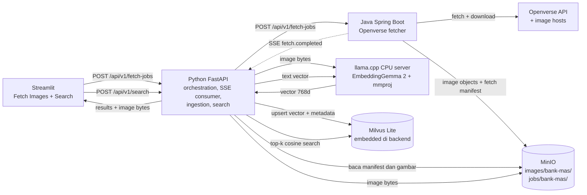
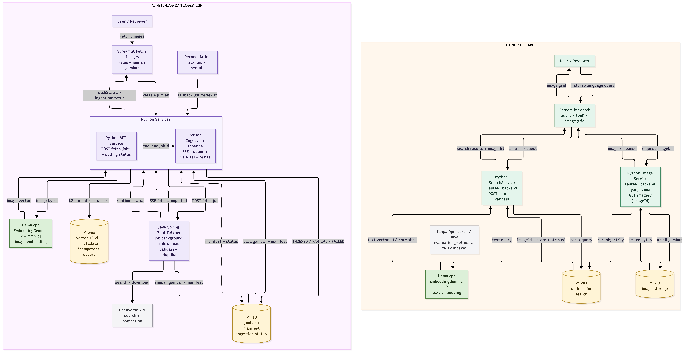

# Bank MAS Image Search

Mini image search untuk take-home assignment Machine Learning Engineer Bank MAS. Sistem mengambil gambar dari Openverse, menyimpannya di MinIO, membuat image embedding dari piksel gambar dengan EmbeddingGemma 2 melalui llama.cpp, menyimpan vector dan metadata di Milvus Lite, lalu menyediakan pencarian natural-language melalui Streamlit.

## Arsitektur



## Flow Fetch & Search


Prinsip utama:

- Pencarian hanya memakai vector dari piksel gambar dan query user. Title, tags, dan nama kelas Openverse hanya berada di `evaluation_metadata` dan tidak dipakai untuk embedding, filter, ranking, atau reranking.
- Java hanya menangani Openverse, download, MinIO, job fetching, manifest, dan SSE.
- Python menangani API, SSE consumer, ingestion, Milvus, search, dan streaming gambar.
- llama.cpp hanya inference service; tidak mengakses MinIO atau Milvus.
- Milvus Lite berjalan di dalam proses backend, sehingga tidak ada service Milvus, etcd, PostgreSQL, Redis, atau RabbitMQ.

## Keputusan desain

**Representasi gambar: image embedding dari piksel, bukan caption atau label.**

Pilihan ini diambil karena tiga alasan. 
1. caption generator menambah satu model generatif yang jauh lebih berat di CPU dan kualitas captionnya menjadi batas atas kualitas search. 
2. label kelas tidak memenuhi aturan brief karena nama kelas berasal dari query fetching, bukan dari piksel. 
3. embedding memungkinkan query bahasa alami langsung dibandingkan dengan gambar tanpa pencocokan kata kunci, sehingga query seperti `a dog playing in the snow` tetap bekerja tanpa daftar label tetap.

**Model: EmbeddingGemma 2 (Q4_K_XL + mmproj Q8_0) melalui llama.cpp.**

Alternatif yang dipertimbangkan adalah CLIP ViT-B/32. CLIP lebih kecil (sekitar 151M parameter, vector 512 dimensi, context teks 77 token) dan lebih sederhana karena image dan text encoder tersedia langsung di Python. EmbeddingGemma 2 dipilih karena beberapa alasan praktis:

- Context 8.192 token jauh lebih longgar untuk query deskriptif panjang, dibanding 77 token pada CLIP.
- Model mendukung 100+ bahasa, sehingga query bahasa Indonesia tetap masuk akal.
- Format GGUF memungkinkan inferensi CPU tanpa PyTorch, dengan footprint bobot sekitar 700 MB untuk dua file yang dipakai.
- Runtime llama.cpp sudah menjadi satu service terpisah, sehingga backend Python tidak perlu memuat model ke dalam prosesnya.

Trade-off yang diterima: EmbeddingGemma 2 lebih berat secara arsitektur (sekitar 440M parameter untuk komponen text+vision), integrasinya lebih sensitif terhadap versi llama.cpp, dan kualitasnya belum dibandingkan secara empiris dengan CLIP pada dataset ini. Repository ini tidak mengklaim salah satu model lebih baik tanpa pengukuran retrieval.

**Penyimpanan: MinIO, bukan folder lokal.**

Brief membolehkan folder lokal. Implementasi memakai MinIO karena objek gambar perlu dibaca oleh dua proses berbeda (Java dan Python) dan manifest job harus tetap ada setelah container restart. Ini asumsi yang dicatat sesuai instruksi brief. Lokasi object tetap deterministik: `images/bank-mas/{sha256}.{ext}`.

## Komponen dan port

| Service | Image / build | Port host (default) | Fungsi |
|---|---|---|---|
| `minio` | `bitnamilegacy/minio:2025.7.23-debian-12-r5` | `127.0.0.1:9000`, console `9001` | Object storage |
| `llama-embeddings` | `ghcr.io/ggml-org/llama.cpp:server-b12429` | `127.0.0.1:8080` | Embedding text + image |
| `fetcher` | `deploy/Containerfile.fetcher` | `127.0.0.1:8081` | Java fetcher + SSE server |
| `backend` | `deploy/Containerfile.backend` | `127.0.0.1:8000` | FastAPI + Milvus Lite |
| `frontend` | `deploy/Containerfile.frontend` | `127.0.0.1:8501` | Streamlit, dua halaman |

## Prerequisites (fresh machine)

- Podman 5.x dan Podman Compose (plugin/provider `podman compose`, atau `podman-compose` 1.x).
- Python 3.10+ di host untuk mengunduh model dan menjalankan smoke test (script memakai standard library).
- `curl` hanya diperlukan jika memilih script Bash alternatif untuk mengunduh model.
- Ruang disk minimal sekitar 5 GB untuk image container, model (~730 MB), dan data.
- RAM: default compose dituning untuk Podman VM 2 GB (context/batch 2048, satu sequence, satu ingestion worker). 2 GB tetap sangat ketat dan OOM masih mungkin terjadi, terutama untuk gambar besar atau ingestion berturut-turut; 8 GB lebih nyaman dan 16 GB lega. Ini pedoman, bukan hasil benchmark.
- Tidak perlu GPU, Docker Desktop, Java, Maven, atau `uv` di host. Build Java dan Python dilakukan di container.
- macOS: jalankan `podman machine init && podman machine start` sekali, lalu pastikan `podman compose version` bekerja.
- Linux dengan SELinux: jika model atau volume gagal dibaca, tambahkan `:z` pada mount model di `deploy/compose.yaml`.

Cek cepat:

```bash
podman --version
podman compose version
curl --version
```

## Setup

### 1. Clone dan environment

```bash
cp .env.example .env
```

Nilai di `.env.example` adalah placeholder lokal yang aman, bukan credentials asli. Ganti `MINIO_ROOT_PASSWORD` sebelum memakai stack untuk hal lain. Jangan commit `.env`.

### 2. Unduh model

```bash
# Windows (PowerShell atau Command Prompt)
py scripts/download_models.py
# Jika launcher py tidak tersedia:
python scripts/download_models.py

# macOS / Linux
python3 scripts/download_models.py
```

Alternatif untuk macOS/Linux dengan `curl`:

```bash
./scripts/download_models.sh
```

Script Python maupun Bash mengunduh dua file dari `unsloth/embeddinggemma-2-GGUF` pada revision yang dipin, lalu memverifikasi ukuran dan SHA-256 sebelum memasangnya:

| File | Ukuran | SHA-256 |
|---|---|---|
| `embeddinggemma-2-UD-Q4_K_XL.gguf` | 175,673,856 bytes | `ea905fd08e8061db77a0031cbb5096d459d7cfd2bdd0ad2ba66e483f16719493` |
| `mmproj-Q8_0.gguf` | 554,821,120 bytes | `90e7b0238009e2954f856f2081dcf7f35af026b64c765e98f4777053e1754460` |

File masuk ke `models/` dan di-ignore Git. Download yang terputus disimpan sebagai `.part` dan dilanjutkan pada run berikutnya. Jika file yang sudah ada tidak cocok dengan checksum, script berhenti dan tidak menimpa file secara diam-diam; gunakan `--force` setelah memeriksa file tersebut. Untuk lingkungan dengan rate limit, set `HF_TOKEN` (tidak pernah dicetak atau ditulis ke disk).

### 3. Jalankan stack

Urutan yang disarankan:

```bash
# 1. Validasi konfigurasi tanpa menjalankan apa pun
podman compose --env-file .env -f deploy/compose.yaml config

# 2. Build image aplikasi dan jalankan semua service
podman compose --env-file .env -f deploy/compose.yaml up --build -d

# 3. Lihat status dan log
podman compose --env-file .env -f deploy/compose.yaml ps
podman compose --env-file .env -f deploy/compose.yaml logs -f llama-embeddings backend
```

Urutan startup yang terjadi:

1. `minio` menyala dan membuat bucket dari `MINIO_DEFAULT_BUCKETS`.
2. `llama-embeddings` memuat model utama dan `mmproj`, lalu membuka port 8080.
3. `fetcher` menyala dan membuka SSE endpoint; `ensureBucket()` Java memastikan bucket tersedia.
4. `backend` menyala, membuka Milvus Lite di volume `milvus-data`, memastikan bucket lewat `ensureBucket()`, lalu connect ke SSE dan melakukan reconciliation.
5. `frontend` menyala, memanggil backend lewat `API_BASE_URL=http://backend:8000`, dan memakai `PUBLIC_API_BASE_URL=http://127.0.0.1:8000` untuk URL gambar yang dibuka browser.

Tidak ada container init one-shot untuk MinIO. Bucket dibuat oleh `MINIO_DEFAULT_BUCKETS` di MinIO dan dijaga oleh `ensureBucket()` di Java/Python. Ini disengaja karena podman-compose 1.4.0 dapat menggantung menunggu `--condition=running` pada service one-shot yang sudah `Exited(0)`.

Compose memakai `depends_on` untuk urutan start, bukan jaminan kesiapan. Service aplikasi memakai restart policy dan harus melakukan retry koneksi saat startup; ini perlu dicek saat integrasi. `x-podman.in_pod: false` membuat Podman Compose tidak menggabungkan semua container ke satu pod, sehingga DNS nama service (`minio`, `backend`, dan seterusnya) dan pemetaan port bekerja seperti Compose biasa.

### 4. Cek kesehatan

```bash
curl -fsS http://127.0.0.1:8080/health   # llama.cpp
curl -fsS http://127.0.0.1:8081/health   # Java fetcher (jika disediakan)
curl -fsS http://127.0.0.1:8000/health   # Python backend
curl -fsS http://127.0.0.1:8000/ready    # Milvus, MinIO, llama.cpp, SSE consumer
```

### 5. Smoke test embedding

```bash
python3 scripts/smoke_test_embeddings.py --base-url http://127.0.0.1:8080
```

Script membuat dua gambar sintetis yang berbeda, mengirim keduanya dengan payload multimodal bertipe:

```json
{
  "model": "embeddinggemma-2",
  "input": [
    {
      "content": [
        {
          "type": "image_url",
          "image_url": {"url": "data:image/png;base64,..."}
        }
      ]
    }
  ]
}
```

Setiap gambar dikirim dalam request terpisah (satu item `input` per request) agar tidak bergantung pada dukungan batching multimodal llama.cpp. Query teks memakai `QUERY_PROMPT_PREFIX` yang sama dengan runtime; kosongkan `--task-prefix` untuk mengirim query mentah. Script memeriksa dimensi 768, nilai finite, dan vector yang berbeda. Untuk pengecekan relevansi yang bermakna, pakai gambar nyata:

```bash
python3 scripts/smoke_test_embeddings.py \
  --base-url http://127.0.0.1:8080 \
  --image-a /path/red-car.jpg \
  --image-b /path/blue-flower.jpg \
  --query "a red car on a street" \
  --strict-relevance
```

Tanpa `--strict-relevance`, perbandingan cosine hanya informasional karena gambar sintetis tidak dijamin punya makna semantik bagi model.

### 6. Buka Streamlit

Buka <http://127.0.0.1:8501>. Ada dua halaman:

1. **Fetch Images** - pilih kelas dan jumlah gambar per kelas, klik **Fetch Images**, lihat `jobId`, polling status fetching dan ingestion, dan gunakan **Retry Ingestion** jika perlu.
2. **Search** - masukkan natural-language query, pilih `top_k`, lalu lihat image grid beserta skor dan atribusi (creator, license, source URL). Title/tags/kelas Openverse tidak dipakai sebagai dasar relevansi.

MinIO console tersedia di <http://127.0.0.1:9001> dengan credentials dari `.env`.

Frontend memisahkan dua URL: `API_BASE_URL=http://backend:8000` untuk panggilan HTTP server-side Streamlit di jaringan compose, dan `PUBLIC_API_BASE_URL=http://127.0.0.1:8000` untuk me-resolve `imageUrl` relatif agar dapat dibuka browser. `PUBLIC_API_BASE_URL` hanya boleh diarahkan ke host/IP remote **setelah** reverse proxy dengan authentication dan TLS tersedia; jangan mengubah `BIND_ADDRESS` atau mengekspos port backend untuk melayani browser remote. `API_BASE_URL` tetap memakai nama service internal.

## Alur fetch, SSE, dan ingestion

1. Streamlit mengirim `POST /api/v1/fetch-jobs` ke backend.
2. Backend meneruskan request ke Java dan mengembalikan `202` + `jobId`.
3. Java fetch Openverse per kelas, download gambar, simpan object ke `images/bank-mas/{sha256}.{ext}`, lalu menulis `jobs/bank-mas/{jobId}/fetch-manifest.json` setelah selesai.
4. Setelah manifest `COMPLETED` tersimpan, Java mengirim SSE `fetch.completed` berisi `jobId` dan `manifestKey`.
5. Backend memvalidasi event, melakukan deduplikasi job, membaca manifest dari MinIO, dan menjalankan ingestion.
6. Untuk setiap gambar: validasi decode, cocokkan SHA-256, kirim hanya image bytes ke llama.cpp, validasi vector 768d, L2-normalize, lalu upsert ke Milvus dengan primary key `image_id`.
7. Backend menulis `jobs/bank-mas/{jobId}/ingestion-status.json` dengan status `PENDING`, `INGESTING`, `INDEXED`, atau `FAILED`.
8. Jika SSE terlewat, backend memakai reconciliation saat startup/berkala dan endpoint `POST /api/v1/ingest/{jobId}`. Re-ingestion aman karena upsert dan ID deterministik.

Catatan runtime:

- **Manifest `PARTIAL` tetap diproses.** Jika manifest berstatus `PARTIAL` karena sebagian download gagal, Python tetap meng-ingest gambar yang berhasil dan `failedDownloads` tetap tercatat. Retry/reconciliation memakai manifest yang sama dan tidak mengunduh ulang gambar dari Openverse.
- **Resize hanya untuk embedding.** Jika gambar melebihi `INGEST_EMBEDDING_MAX_DIMENSION`, backend memperkecil salinan di memori sebelum mengirim ke llama.cpp. Object asli di MinIO, object key, dan SHA-256 tidak diubah; resize tidak menimpa file asli.
- **Openverse timeout 20 detik.** Default dinaikkan dari 8 detik karena respons Openverse sering lebih lambat dari batas lama. Retry policy dan backoff tidak diubah; timeout ini hanya memberi ruang per request.
- **Embedding retry dan MinIO pool.** Backend mencoba ulang embedding hingga `EMBEDDING_MAX_ATTEMPTS` dengan backoff `EMBEDDING_RETRY_INITIAL_SECONDS` sampai `EMBEDDING_RETRY_MAX_SECONDS`, dan memakai `MINIO_POOL_MAXSIZE` koneksi.

SSE bukan durable queue. Manifest dan ingestion status di MinIO adalah catatan persisten; status runtime di Java/Python bisa hilang saat restart.

## Konvensi MinIO

Satu bucket aplikasi, nama default `bank-mas-image-search` (configurable lewat `MINIO_BUCKET`):

```text
images/bank-mas/{sha256}.{extension}
jobs/bank-mas/{jobId}/fetch-manifest.json
jobs/bank-mas/{jobId}/ingestion-status.json
```

Prefix dikonfigurasi lewat `MINIO_IMAGES_PREFIX` dan `MINIO_JOBS_PREFIX` dengan nilai default di atas. Jangan memakai prefix lama. Prefix bukan direktori nyata di S3/MinIO; bucket dibuat oleh `MINIO_DEFAULT_BUCKETS` dan `ensureBucket()` service, sedangkan object key dibuat oleh service.

## Environment penting

Semua variabel ada di `.env.example`. Ringkasan:

| Variabel | Default | Dipakai oleh |
|---|---|---|
| `MINIO_ROOT_USER`, `MINIO_ROOT_PASSWORD` | placeholder lokal | MinIO, fetcher, backend |
| `MINIO_BUCKET` | `bank-mas-image-search` | MinIO, fetcher, backend |
| `MINIO_ENDPOINT` / `MINIO_ENDPOINT_HOST` | `http://minio:9000` / `minio:9000` | fetcher / backend |
| `MINIO_IMAGES_PREFIX`, `MINIO_JOBS_PREFIX` | `images/bank-mas/`, `jobs/bank-mas/` | fetcher, backend |
| `MODELS_DIR` | `../models` (relatif ke `deploy/`) | llama.cpp |
| `MODEL_FILE`, `MMPROJ_FILE` | dua file GGUF di atas | llama.cpp |
| `LLAMA_CTX_SIZE` | `2048` | llama.cpp |
| `LLAMA_BATCH_SIZE`, `LLAMA_UBATCH_SIZE` | `2048` | llama.cpp |
| `LLAMA_THREADS` | `4` | llama.cpp |
| `OPENVERSE_BASE_URL` | `https://api.openverse.org` | fetcher |
| `OPENVERSE_REQUEST_TIMEOUT` | `20s` | fetcher |
| `OPENVERSE_CLIENT_ID`, `OPENVERSE_CLIENT_SECRET` | kosong | fetcher (opsional) |
| `FETCHER_HTTP_MAX_REDIRECTS` | `5` | fetcher |
| `FETCHER_SSE_MAX_SUBSCRIBERS` | `8` | fetcher |
| `MILVUS_DB_PATH` | `/data/milvus.db` | backend (Milvus Lite) |
| `MILVUS_COLLECTION` | `image_embeddings` | backend |
| `LLAMA_BASE_URL` | `http://llama-embeddings:8080` | backend |
| `EMBEDDING_MAX_ATTEMPTS` | `5` | backend |
| `EMBEDDING_RETRY_INITIAL_SECONDS`, `EMBEDDING_RETRY_MAX_SECONDS` | `1`, `15` | backend |
| `INGEST_EMBEDDING_MAX_DIMENSION` | `1024` | backend |
| `MINIO_POOL_MAXSIZE` | `32` | backend |
| `QUERY_PROMPT_PREFIX` | `task: search result \| query:` | backend |
| `RECONCILIATION_INTERVAL_SECONDS` | `120` | backend |
| `INGEST_BATCH_SIZE` | `1` | backend |
| `INGEST_MAX_IMAGE_PIXELS` | `25000000` | backend |
| `API_BASE_URL` | `http://backend:8000` | frontend server-side (internal compose) |
| `PUBLIC_API_BASE_URL` | `http://127.0.0.1:8000` | frontend / browser (URL gambar) |

Nama variabel di atas adalah kontrak deployment yang dicocokkan dengan implementasi branch `feature/java-fetcher`, `feature/python-backend`, dan `feature/streamlit-frontend`: Java memakai `FETCHER_PORT`, `FETCHER_HTTP_MAX_REDIRECTS`, `FETCHER_SSE_MAX_SUBSCRIBERS`, `OPENVERSE_BASE_URL`, `OPENVERSE_REQUEST_TIMEOUT`, `MINIO_IMAGES_PREFIX`, `MINIO_JOBS_PREFIX`; backend memakai `JAVA_BASE_URL`, `IMAGE_PREFIX`, `JOBS_PREFIX`, `QUERY_PROMPT_PREFIX`, `EMBEDDING_MAX_ATTEMPTS`, `EMBEDDING_RETRY_INITIAL_SECONDS`, `EMBEDDING_RETRY_MAX_SECONDS`, `INGEST_BATCH_SIZE`, `INGEST_EMBEDDING_MAX_DIMENSION`, `INGEST_MAX_IMAGE_PIXELS`, `MINIO_POOL_MAXSIZE`, `RECONCILIATION_*`; frontend memakai `API_BASE_URL`, `PUBLIC_API_BASE_URL`, `API_TIMEOUT_SECONDS`, `API_SEARCH_TIMEOUT_SECONDS`, `FRONTEND_POLL_INTERVAL_SECONDS`. Jika implementasi berubah, sesuaikan `deploy/compose.yaml` dan `.env.example` bersama-sama, jangan mengganti nama prefix default.

## Model dan image pinning

### Model

- Model utama: `embeddinggemma-2-UD-Q4_K_XL.gguf` (Unsloth Dynamic 3.0 quant).
- Multimodal projector: `mmproj-Q8_0.gguf`. File ini wajib dimuat agar image embedding bekerja.
- Output native 768 dimensi, mean pooling, dan L2-normalized untuk cosine similarity.
- Teks memakai task prefix; gambar tidak memakai prefix.
- Revision Hugging Face dipin ke commit `031f0d4b35536f69ab3509d4893c923264fcf253`.
- File model tidak di-commit. Lisensi mengikuti model card di Hugging Face.

### llama.cpp image

Image dipin ke `ghcr.io/ggml-org/llama.cpp:server-b12429` (saat file ini ditulis, tag tersebut me-resolve ke digest `sha256:7751a6c0dc3d019c231d42678abbb0fac1a13a24c17c956109ed27533139f280`). EmbeddingGemma 2 membutuhkan build dengan dukungan multimodal embeddings dan `--mmproj`; build lama atau build tanpa dukungan tersebut tidak akan menghasilkan image embedding yang benar.

Payload multimodal bertipe (nested `content` parts di dalam setiap item `input`) mengikuti kontrak di `docs/rencana-implementasi.md` dan bentuk yang dilaporkan berhasil di issue upstream `ggml-org/llama.cpp#30082`. Tetap jalankan `scripts/smoke_test_embeddings.py` setelah mengganti image; jangan menganggap tag ini otomatis kompatibel.

Default CPU: `--n-gpu-layers 0`, `--parallel 1`, `--threads 4`, context/batch 2048, dan batas image token 280 sesuai model card. Nilai 2048 dipilih agar KV cache dan batch tidak menghabiskan Podman VM 2 GB; jangan menaikkannya tanpa menambah memori VM. Naikkan `LLAMA_THREADS` mendekati jumlah core fisik.

### MinIO image

MinIO tidak lagi menyediakan image komunitas anonim di Docker Hub, dan `quay.io/minio/minio` meminta autentikasi saat diverifikasi. Supaya mesin baru bisa menarik image tanpa login registry, compose memakai mirror legacy Bitnami yang dipin:

- `docker.io/bitnamilegacy/minio:2025.7.23-debian-12-r5`

Image ini tidak mendapat update vendor. Untuk deployment non-local, ganti dengan image MinIO resmi yang tersedia di registry berlangganan/terautentikasi setelah kontrol authentication dan TLS tersedia, lalu sesuaikan environment-nya. Fungsionalitas S3 yang dipakai proyek ini hanya bucket dan object biasa.

## Testing

Perintah yang relevan setelah semua source tersedia:

```bash
# Java unit tests
cd fetcher && ./mvnw test        # atau: mvn test

# Python unit tests
cd backend && uv run pytest

# Smoke test integrasi embedding (butuh llama.cpp berjalan)
python3 scripts/smoke_test_embeddings.py --base-url http://127.0.0.1:8080

# Cek endpoint
curl -fsS http://127.0.0.1:8000/health
curl -fsS http://127.0.0.1:8000/ready
```

Skenario integrasi manual minimal:

1. Fetch dua kelas dengan jumlah kecil dari halaman **Fetch Images**.
2. Pastikan manifest muncul di `jobs/bank-mas/{jobId}/fetch-manifest.json`.
3. Pastikan ingestion berjalan otomatis setelah SSE, lalu status menjadi `INDEXED`.
4. Cari query natural-language dan pastikan hasil berasal dari koleksi lokal.
5. Jalankan retry ingestion untuk job yang sama dan pastikan jumlah row Milvus tidak bertambah.
6. Restart backend dan pastikan reconciliation memproses job yang event SSE-nya terlewat.

## Validasi

Yang benar-benar dijalankan:

**Test otomatis**

- `fetcher`: `mvn test` di container Maven 3.9.11 + Temurin 21 - **103 test lulus**, 0 gagal.
- `backend`: `uv run pytest` - seluruh test lulus, termasuk Milvus Lite embedded.
- `frontend`: `uv run pytest` - seluruh test lulus.
- `backend`: `ruff check app` - lulus tanpa temuan.

**End-to-end di VPS (Podman, Ubuntu 24.04)**

- Build image `fetcher`, `backend`, dan `frontend` berhasil pada commit `1984cb1`.
- `scripts/smoke_test_embeddings.py` terhadap llama.cpp nyata: vector 768 dimensi, norm 1.0, embedding gambar dan teks berbeda, exit 0.
- Fetch job nyata dari Openverse sampai `fetchStatus=COMPLETED` dan `ingestionStatus=INDEXED`.
- Retry ingestion pada job yang sama menghasilkan `indexed=0` dan `duplicates=1`, jadi idempotensi terbukti.
- `POST /api/v1/search` dan `GET /api/v1/images/{imageId}` berhasil melalui gateway publik, mengembalikan `image/jpeg`.
- Runtime status pada `/ready` menunjukkan Milvus, MinIO, llama.cpp, dan SSE consumer siap.

**Konfigurasi**

- `podman compose --env-file .env -f deploy/compose.yaml config` - exit 0.
- `podman compose --env-file .env.vps -f deploy/compose.vps.yaml config --quiet` - exit 0 di VPS.

Yang **belum** dilakukan: benchmark latency formal, load test, dan evaluasi dengan anotasi relevansi manual. `precision@10` sudah diukur, tetapi memakai weak labels dari `requestedClass`, bukan anotasi visual manual.

## Data dan kelas

Dataset yang benar-benar di-ingest pada VPS saat validasi:

| Item | Nilai |
|---|---|
| Fetch job | 5 |
| Entri gambar di manifest | 1.295 |
| Gambar unik di MinIO (`images/bank-mas/`) | 566 |
| Kelas unik yang di-fetch | 25 |
| Vector di Milvus | 566 |

Kelas yang di-fetch saat validasi (25 kelas):

| Kelas | Gambar di manifest | Vector unik di Milvus |
|---|---:|---:|
| beach | 27 | 27 |
| bird | 65 | 22 |
| boat | 65 | 22 |
| bridge | 65 | 22 |
| building | 65 | 22 |
| car | 65 | 22 |
| cat | 65 | 22 |
| chair | 65 | 22 |
| dog | 65 | 22 |
| elephant | 65 | 23 |
| fish | 27 | 26 |
| flower | 65 | 22 |
| goat | 65 | 22 |
| horse | 65 | 23 |
| mountain | 65 | 22 |
| pie | 65 | 22 |
| pizza | 65 | 22 |
| rain | 27 | 27 |
| red apple | 1 | 1 |
| sail | 27 | 27 |
| sea | 27 | 27 |
| ship | 27 | 27 |
| sunset | 27 | 27 |
| train | 65 | 22 |
| tree | 65 | 23 |
| **Total** | **1.295** | **566** |

Selisih antara kolom manifest dan vector unik berasal dari duplikat: beberapa job mengambil gambar yang sama, dan ingestion melewati gambar dengan SHA-256 yang sudah ada. Jumlah vector dihitung langsung dari collection Milvus, bukan diperkirakan dari jumlah file di MinIO.

Kelas di atas berasal dari kombinasi daftar default aplikasi dan input manual saat pengujian. Daftar default aplikasi berisi 20 kelas yang sama dengan rencana di [docs/rencana-implementasi.md](docs/rencana-implementasi.md):

| Kelas default (20) |
|---|
| dog, cat, elephant, bicycle, car, airplane, pizza, chair, tree, flower, building, bridge, boat, train, bird, horse, cake, laptop, guitar, mountain |

Lima kelas default (`bicycle`, `airplane`, `cake`, `laptop`, `guitar`) belum di-fetch pada validasi di VPS, sehingga belum memiliki vector di tabel atas. Fetch tetap dapat dijalankan untuk kelas tersebut dari halaman **Fetch Images**.

Evaluasi retrieval menggunakan exact class match terhadap `evaluation_metadata.requestedClass`. Lihat metode dan hasil pada bagian [Evaluasi precision@k](#evaluasi-precisionk).

Semua gambar berasal dari Openverse dengan lisensi terbuka. Creator, nama lisensi, dan source URL ditampilkan pada setiap hasil. Penggunaan dibatasi untuk assignment ini.

## Evaluasi precision@k

Implementasi tersedia di `backend/app/evaluate.py` dan `backend/app/evaluation.py`, dengan test di `backend/tests/test_evaluation.py`.

Metode yang digunakan:

1. Setiap `requestedClass` yang tersimpan menjadi satu query, misalnya `dog`.
2. Query diubah menjadi text embedding memakai model dan prefix yang sama dengan runtime.
3. Milvus melakukan top-k COSINE search tanpa membaca `evaluation_metadata`.
4. Setelah ranking selesai, script membaca `requestedClass` hanya untuk `imageId` yang muncul di hasil.
5. Hasil dianggap relevan jika normalized class sama persis dengan query. Tidak ada alias seperti `boat = ship`, fuzzy match, title, atau tags.
6. `precision@k = relevant / k`. Macro precision adalah rata-rata precision seluruh kelas yang dievaluasi.

Evaluasi sengaja memakai snapshot Milvus Lite agar database aktif tetap single-process:

```bash
cd backend
# Jalankan copy hanya ketika tidak ada ingestion yang berjalan.
cp data/milvus.db /tmp/milvus-evaluation.db
uv run python -m app.evaluate \
  --db-path /tmp/milvus-evaluation.db \
  --k 10 \
  --output ../docs/precision-at-10.json
```

Gunakan `--classes dog,cat` untuk subset atau `--min-images 20` untuk mengabaikan kelas yang datanya terlalu sedikit.

Hasil aktual pada 566 gambar dan 25 kelas:

| Metrik | Nilai |
|---|---:|
| Macro precision@10 | **0,9120** |
| `boat` | 0,6000 |
| `mountain` | 0,7000 |
| `beach`, `sea` | 0,8000 |
| `ship`, `sunset` | 0,9000 |
| `red apple` | 0,1000, hanya 1 gambar |

Report lengkap tersimpan di [docs/precision-at-10.json](docs/precision-at-10.json). Angka ini **bukan anotasi visual manual**. Label kelas Openverse adalah ground truth lemah, kelas visual dapat tumpang tindih, dan kelas dengan sedikit gambar menghasilkan skor yang tidak stabil. Karena itu hasil ini adalah indikator awal, bukan klaim kualitas model yang universal.

## Contoh query dan screenshot

Dua contoh diambil dari aplikasi yang berjalan (`https://image-search.muhamad-wahid.my.id`), dengan `topK = 12`.

**Query satu kata: `dog`**


**Query bahasa alami: `a dog playing in the snow`**


Query kedua menunjukkan hasil yang relevan secara visual (anjing di salju) tanpa pencocokan kata kunci terhadap title atau tags Openverse. Screenshot ini adalah bukti hasil yang benar-benar dijalankan, bukan mockup.

## Known limitations

- SSE tidak memberikan durable delivery atau replay. Reconciliation dan retry manual adalah fallback, bukan pengganti SSE.
- Status job Java dan progress ingestion Python dapat hilang saat restart; manifest dan `ingestion-status.json` tetap ada di MinIO.
- Milvus Lite adalah embedded single-process database, bukan Milvus cluster. Satu backend worker adalah keputusan desain, bukan konfigurasi produksi.
- Ingestion CPU bisa lambat, terutama untuk gambar besar dan banyak gambar per kelas.
- Kualitas embedding dapat turun karena quantisasi Q4 dibandingkan model presisi penuh.
- Model multimodal membutuhkan llama.cpp build yang tepat. Smoke test wajib dijalankan setelah mengganti image/tag.
- Batas image token 280 mengikuti model card; jika build llama.cpp tidak menghormatinya, gambar besar dapat melebihi context dan gagal. Backend membatasi dimensi embedding lewat `INGEST_EMBEDDING_MAX_DIMENSION`, tetapi object asli di MinIO tetap utuh. VM 2 GB tetap ketat dan OOM mungkin terjadi pada gambar besar atau concurrency tinggi.
- Image MinIO memakai mirror legacy; lihat bagian MinIO image.
- Evaluasi memakai weak labels dari `requestedClass`, bukan anotasi visual manual. Kelas yang mirip dan data sedikit dapat menurunkan `precision@k` tanpa membuktikan model gagal.
- Containerfile mengasumsikan struktur yang didokumentasikan: `fetcher/pom.xml` + `fetcher/src`, `backend/app/main.py` + `backend/pyproject.toml`, `frontend/app.py` + `frontend/image_search/`. Penyesuaian diperlukan jika implementasi memakai layout lain.
- Tidak ada authentication atau TLS di stack ini. Jangan mengekspos port ke VPS/internet; gunakan reverse proxy yang menyediakan authentication dan TLS jika akses remote benar-benar diperlukan. `PUBLIC_API_BASE_URL` remote hanya boleh dipakai setelah kontrol tersebut tersedia. Frontend juga harus benar-benar membaca `PUBLIC_API_BASE_URL`.

## Troubleshooting

- **`podman compose` tidak menemukan provider**: install `podman-compose` atau jalankan `podman-compose` langsung; perintah di README kompatibel dengan keduanya.
- **`llama-embeddings` restart terus**: cek `podman compose ... logs llama-embeddings`. Penyebab umum: model belum diunduh, nama file salah, `MODELS_DIR` tidak dapat diakses container, atau image tidak mendukung EmbeddingGemma 2.
- **Healthcheck llama.cpp gagal**: model besar butuh waktu load. Lihat log; healthcheck punya `start_period` 180 detik.
- **Bucket tidak ada**: cek log `minio`, pastikan credentials di `.env` sama untuk MinIO dan service aplikasi, lalu cek log `ensureBucket()` di fetcher/backend.
- **Mengganti password MinIO tidak berpengaruh**: MinIO dengan volume persisten memakai keys hasil inisialisasi pertama. Hapus volume `minio-data` atau set `MINIO_FORCE_NEW_KEYS=yes` sekali, lalu sinkronkan credentials di service lain.
- **Backend tidak siap**: `GET /ready` menunjukkan dependensi mana yang gagal. Pastikan MinIO, llama.cpp, dan Java fetcher sudah siap.
- **Milvus Lite tidak bisa menulis**: pastikan volume `milvus-data` tidak di-mount read-only dan user container memiliki akses ke `/data`. Untuk reset data lokal, hapus volume dengan `podman volume rm` setelah stack dihentikan.
- **Ingestion gagal setelah SSE terlewat**: gunakan tombol **Retry Ingestion** atau `POST /api/v1/ingest/{jobId}`; jangan menjalankan dua ingestion untuk job yang sama secara bersamaan.
