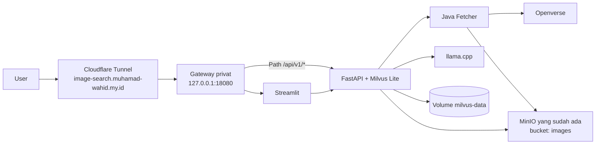

# Rencana Deployment Bank MAS Image Search ke VPS

## 1. Status dokumen

Dokumen ini awalnya disusun sebagai rencana berdasarkan inspeksi read-only. Deployment kemudian dilaksanakan pada commit `1984cb1` dan subdomain `image-search.muhamad-wahid.my.id` sudah aktif. Catatan hasil implementasi dan keputusan akses publik telah dimasukkan ke dokumen ini.

Prinsip utama:

- Gunakan MinIO dan bucket `images` yang sudah ada.
- Jangan membuat bucket baru atau menjalankan container MinIO kedua.
- Jangan mengganggu Plane, Hindsight, Open WebUI, PostgreSQL, Qdrant, maupun service lain yang sudah berjalan.
- Gunakan Podman dan Compose provider yang sudah tersedia.
- Jalankan validasi secara bertahap, mulai dari akses privat melalui SSH tunnel.
- Jangan membuka service aplikasi langsung ke internet.
- Dokumen ini tidak memuat nilai credential. Semua nilai rahasia hanya ditulis sebagai placeholder.

## 2. Hasil inspeksi VPS

| Item | Kondisi saat diperiksa | Keputusan untuk deployment |
|---|---|---|
| OS | Ubuntu 24.04.4 LTS | Dapat digunakan |
| CPU | 6 vCPU | Awalnya gunakan 4 thread untuk llama.cpp |
| RAM | Sekitar 12 GB, available sekitar 7.4 GB saat diperiksa | Cukup untuk percobaan bertahap, tetap perlu monitoring |
| Swap | Tidak ada | Jangan menjalankan ingestion besar sekaligus |
| Disk | Sekitar 387 GB, tersedia sekitar 333 GB | Cukup untuk image container, model, dan data awal |
| Container runtime | Podman 4.9.3 | Gunakan Podman |
| Compose provider | `docker-compose` 1.29.2 melalui `podman compose` | Hindari fitur Compose versi baru |
| MinIO | Container `minio` berjalan dan health check HTTP 200 | Gunakan instance ini |
| Bucket | `images`, `videos`, dan `plane-uploads` | Gunakan hanya bucket `images` |
| Isi bucket `images` | Saat dicek hanya terlihat `README.md` di root | Prefix aplikasi tidak bertabrakan dengan data yang terlihat |
| MinIO network | `minio_minio-network` | Daftarkan sebagai external network |
| MinIO DNS | Alias `minio` di network tersebut | Backend dan fetcher dapat memakai `minio:9000` |
| Cloudflare Tunnel | Sudah berjalan | Tambahkan public hostname `image-search.muhamad-wahid.my.id` |
| Proxy publik | Port `80/443` dipakai `plane_proxy_1` | Jangan menambah listener baru di `80/443` |
| Port aplikasi | `8000`, `8081`, `8501`, dan `18080` kosong saat dicek | Tetap bind hanya ke `127.0.0.1` |
| Port `8080` | Tidak ada listener, tetapi sudah dirujuk konfigurasi ingress hostname lain | Jangan publish llama.cpp ke host port `8080` |
| Koneksi Openverse | Request percobaan menghasilkan HTTP 200 | Fetcher dapat mengakses Openverse |

Catatan: kondisi resource dapat berubah. Periksa ulang CPU, RAM, disk, port, network, dan bucket tepat sebelum deployment.

## 3. Arsitektur target

Service baru yang dijalankan:

1. `llama-embeddings`: llama.cpp dengan model EmbeddingGemma 2.
2. `fetcher`: Java Spring Boot untuk Openverse, download, manifest, dan SSE.
3. `backend`: FastAPI, ingestion, Milvus Lite, search, dan image endpoint.
4. `frontend`: Streamlit.
5. `gateway`: reverse proxy kecil, hanya diperlukan untuk akses publik satu hostname.

Service yang **tidak** dibuat:

- MinIO baru.
- Bucket baru.
- Milvus server, etcd, PostgreSQL, Qdrant, Redis, atau RabbitMQ baru.
- Reverse proxy pada host port `80/443`.



### Network

Gunakan dua network:

- `app-net`: external network `bank-mas-image-search-net` untuk `gateway`, `frontend`, `backend`, `fetcher`, dan `llama-embeddings`. Network ini dibuat satu kali dengan subnet `10.89.88.0/24` agar stabil saat container di-recreate.
- `minio_minio-network`: network MinIO yang sudah ada dan didaftarkan sebagai `external: true`.

```bash
podman network create --driver bridge --subnet 10.89.88.0/24 bank-mas-image-search-net
```

Hanya `backend` dan `fetcher` yang perlu terhubung ke `minio_minio-network`. Frontend, gateway, dan llama.cpp tidak memerlukan akses langsung ke MinIO.

### Prefix object

Gunakan namespace berikut di dalam bucket `images`:

```text
images/bank-mas/       # bytes gambar
jobs/bank-mas/         # fetch manifest dan ingestion status
```

Dengan demikian object berada di:

```text
s3://images/images/bank-mas/...
s3://images/jobs/bank-mas/...
```

Jangan mengganti nama prefix lama aplikasi karena backend memvalidasi prefix object dan manifest.

## 4. Perubahan project yang perlu disiapkan

Perubahan ini baru dilakukan saat implementasi deployment, bukan sebagai bagian dari dokumen rencana ini:

1. Tambahkan `deploy/compose.vps.yaml` khusus VPS.
2. Tambahkan konfigurasi gateway `deploy/Caddyfile.vps` untuk `image-search.muhamad-wahid.my.id`.
3. Tambahkan `deploy/.env.vps.example` berisi placeholder tanpa credential.
4. Tambahkan script operasional bila diperlukan: validasi, backup, dan rollback.
5. Jangan mengubah `deploy/compose.yaml` lokal kecuali ada kebutuhan yang kompatibel dengan deployment lokal.

`compose.vps.yaml` perlu berbeda dari compose lokal karena:

- Service `minio` lokal harus dihilangkan.
- MinIO diganti external network yang sudah ada.
- llama.cpp tidak memakai host port `8080`.
- Fetcher tidak perlu dipublish ke host.
- Milvus memakai named volume khusus aplikasi.
- Gateway menjadi satu-satunya entry point saat akses publik diaktifkan.

## 5. Persiapan MinIO dan credential

### Bucket

Gunakan konfigurasi berikut:

```dotenv
MINIO_BUCKET=images
MINIO_ENDPOINT=http://minio:9000
MINIO_ENDPOINT_HOST=minio:9000
MINIO_SECURE=false
MINIO_ENSURE_BUCKET=false
MINIO_IMAGES_PREFIX=images/bank-mas/
MINIO_JOBS_PREFIX=jobs/bank-mas/
```

`MINIO_SECURE=false` hanya untuk komunikasi HTTP di dalam network container. Browser tidak berkomunikasi langsung dengan MinIO.

### Credential aplikasi

Jangan memakai credential root MinIO untuk backend dan fetcher. Buat credential khusus aplikasi saat deployment dengan izin minimum untuk:

- Memeriksa bucket `images`.
- Membaca dan menulis object di `images/bank-mas/`.
- Membaca dan menulis object di `jobs/bank-mas/`.
- Membaca daftar object yang diperlukan reconciliation.

Tidak perlu memberikan izin ke bucket lain. Idealnya credential tidak memiliki izin membuat bucket, sehingga salah konfigurasi nama bucket tidak membuat bucket baru melalui fetcher.

Simpan credential hanya di file environment VPS dengan permission `600`. Jangan menuliskannya pada:

- Dokumen Markdown.
- Git repository.
- Compose file.
- Log deployment.
- Screenshot atau output terminal yang dibagikan.

Gunakan `podman compose ... config --quiet` untuk validasi. Jangan menampilkan hasil `podman compose config` lengkap karena hasil render dapat memuat credential.

## 6. Konfigurasi aplikasi

Nilai berikut bukan credential dan dapat digunakan sebagai baseline:

```dotenv
COMPOSE_PROJECT_NAME=bank-mas-image-search
BIND_ADDRESS=127.0.0.1
LOG_LEVEL=INFO

JAVA_BASE_URL=http://fetcher:8081
JAVA_EVENTS_PATH=/api/v1/events/fetch
SSE_ENABLED=true

LLAMA_BASE_URL=http://llama-embeddings:8080
LLAMA_MODEL=embeddinggemma-2
LLAMA_MODEL_ALIAS=embeddinggemma-2
LLAMA_THREADS=4
LLAMA_CTX_SIZE=2048
LLAMA_BATCH_SIZE=2048
LLAMA_UBATCH_SIZE=2048
LLAMA_TIMEOUT_SECONDS=180

MILVUS_DB_PATH=/data/milvus.db
MILVUS_COLLECTION=image_embeddings
EMBEDDING_DIMENSION=768
INGEST_BATCH_SIZE=1
INGEST_EMBEDDING_MAX_DIMENSION=1024

FETCHER_JOB_WORKER_THREADS=1
RECONCILIATION_ENABLED=true
RECONCILIATION_ON_STARTUP=true
RECONCILIATION_RETRY_FAILED=false

API_BASE_URL=http://backend:8000
API_SEARCH_TIMEOUT_SECONDS=90
FRONTEND_POLL_INTERVAL_SECONDS=3
```

Credential MinIO dan credential Openverse opsional diisi langsung di VPS:

```dotenv
MINIO_ACCESS_KEY=<DIISI_LANGSUNG_DI_VPS>
MINIO_SECRET_KEY=<DIISI_LANGSUNG_DI_VPS>
OPENVERSE_CLIENT_ID=<OPSIONAL_DIISI_LANGSUNG_DI_VPS>
OPENVERSE_CLIENT_SECRET=<OPSIONAL_DIISI_LANGSUNG_DI_VPS>
```

Jangan memakai variabel `MINIO_ROOT_USER` atau `MINIO_ROOT_PASSWORD` pada compose VPS karena tidak ada container MinIO baru yang perlu diinisialisasi.

### Pemetaan port awal

| Service | Container port | Host port awal | Akses |
|---|---:|---:|---|
| backend | 8000 | `127.0.0.1:8000` | SSH tunnel dan health check |
| frontend | 8501 | `127.0.0.1:8501` | SSH tunnel |
| llama-embeddings | 8080 | `127.0.0.1:18081` | Smoke test, menghindari ingress lama di `8080` |
| fetcher | 8081 | Tidak dipublish | Hanya backend melalui `app-net` |
| gateway | 80 | `127.0.0.1:18080` | Cloudflare Tunnel, saat fase publik |

Tidak ada port aplikasi yang dibuka ke internet melalui UFW. Saat implementasi, DNS Podman dari container ternyata terblokir UFW. Karena itu ditambahkan rule DNS internal berikut agar service-name dan alias MinIO dapat di-resolve:

```bash
ufw allow from 10.89.88.0/24 to any port 53 comment "bank-mas-image-search internal DNS"
ufw allow from 172.25.0.0/16 to any port 53 comment "bank-mas-image-search MinIO network DNS"
```

Rule ini hanya mengizinkan DNS dari network container privat. Port `8000`, `8501`, `18080`, dan `18081` tetap terikat ke `127.0.0.1`.

## 7. Tahapan deployment

### Fase A: persiapan source dan model

1. Pilih commit yang sudah ditest dan jadikan commit tersebut acuan rilis.
2. Letakkan source di `/root/app/bank-mas-image-search`, mengikuti pola direktori aplikasi yang sudah ada.
3. Salin dua model dari project lokal:
   - `embeddinggemma-2-UD-Q4_K_XL.gguf`
   - `mmproj-Q8_0.gguf`
4. Mount direktori model sebagai read-only ke `/models` di container llama.cpp.
5. Verifikasi SHA-256 model setelah penyalinan. Hash model lokal yang saat ini tercatat:

```text
embeddinggemma-2-UD-Q4_K_XL.gguf
ea905fd08e8061db77a0031cbb5096d459d7cfd2bdd0ad2ba66e483f16719493

mmproj-Q8_0.gguf
90e7b0238009e2954f856f2081dcf7f35af026b64c765e98f4777053e1754460
```

6. Siapkan `.env.vps` langsung di VPS dan set permission `600`.
7. Validasi Compose tanpa mencetak environment:

```bash
podman compose --env-file .env.vps -f deploy/compose.vps.yaml config --quiet
```

### Fase B: build dan start bertahap

1. Build image `fetcher`, `backend`, dan `frontend` secara bergantian untuk mengurangi lonjakan resource.
2. Gunakan tag image berbasis commit agar rollback jelas.
3. Start `llama-embeddings` terlebih dahulu.
4. Tunggu health check llama.cpp berhasil. Model besar membutuhkan waktu load.
5. Dari laptop, buka SSH tunnel ke `127.0.0.1:18081` VPS, lalu jalankan smoke test text dan image embedding:

```bash
uv run --no-project scripts/smoke_test_embeddings.py \
  --base-url http://127.0.0.1:18081
```

Jika test dijalankan langsung di VPS, gunakan `python3` karena script hanya memakai Python standard library dan `uv` tidak terpasang di VPS saat inspeksi.

6. Start `fetcher`, kemudian `backend`, lalu `frontend`.
7. Periksa container status, health check, log, RAM, dan disk setelah setiap tahap.
8. Jangan melanjutkan jika llama.cpp restart, backend tidak ready, MinIO tidak dapat diakses, atau SSE consumer tidak tersambung.

### Fase C: validasi privat

Akses awal menggunakan SSH tunnel, bukan internet publik.

Untuk tahap ini, konfigurasi frontend:

```dotenv
PUBLIC_API_BASE_URL=http://127.0.0.1:18000
```

Buat tunnel dari laptop:

```text
laptop:18501 -> VPS:127.0.0.1:8501
laptop:18000 -> VPS:127.0.0.1:8000
```

Frontend dibuka melalui `http://127.0.0.1:18501`. Image URL akan memakai `http://127.0.0.1:18000` melalui tunnel yang sama.

Validasi minimum:

1. `GET /health` backend berhasil.
2. `GET /ready` backend berhasil dan tidak ada dependensi gagal.
3. Health endpoint Streamlit berhasil.
4. Buat satu fetch job kecil: satu kelas dan satu gambar.
5. Pastikan fetch job mendapat HTTP 202 dan `jobId`.
6. Tunggu `fetchStatus` selesai dan `ingestionStatus` menjadi `INDEXED`.
7. Pastikan object gambar berada di prefix `images/bank-mas/` pada bucket `images`.
8. Pastikan manifest dan ingestion status berada di `jobs/bank-mas/`.
9. Jalankan search dengan query yang sesuai gambar.
10. Pastikan hasil search menampilkan gambar, creator, lisensi, dan source URL.
11. Jalankan retry ingestion pada job yang sama dan pastikan tidak ada duplikasi vector.
12. Pastikan tidak ada bucket baru yang tercipta.

## 8. Akses publik melalui Cloudflare Tunnel

Frontend akan tersedia di:

```text
https://image-search.muhamad-wahid.my.id
```

Aplikasi tidak memiliki authentication dan authorization sendiri. **Pada deployment ini pengguna memilih membuka subdomain tanpa Cloudflare Access.** Akibatnya, siapa pun yang mengetahui domain dapat memakai fetch, search, embedding, dan resource VPS. Access tetap disarankan sebagai hardening lanjutan.

### 8.1 Target koneksi

```text
Browser
  -> Cloudflare Tunnel yang sudah ada
  -> http://127.0.0.1:18080
  -> gateway container
       -> frontend:8501 untuk halaman Streamlit
       -> backend:8000 untuk path /api/v1/*
```

Cloudflared berjalan langsung di host, sehingga target service menggunakan `127.0.0.1:18080`, bukan nama container `gateway`.

Jangan mengubah konfigurasi `plane_proxy_1`, jangan memakai host port `80/443`, dan jangan mengubah ingress hostname lain. Port `8000`, `8501`, `18081`, `9000`, dan `9001` tidak perlu dibuka ke internet.

### 8.2 Routing gateway

Gunakan konfigurasi berikut sebagai baseline `deploy/Caddyfile.vps`:

```caddyfile
:80 {
    encode zstd gzip

    handle /api/v1/* {
        reverse_proxy backend:8000
    }

    handle {
        reverse_proxy frontend:8501
    }
}
```

Caddy meneruskan WebSocket yang dibutuhkan Streamlit. Path `/api/v1` tidak di-strip karena backend memang memakai prefix tersebut. TLS ditangani Cloudflare, sedangkan gateway hanya menerima HTTP dari loopback host.

### 8.3 Ingress Cloudflare Tunnel

Tambahkan entri berikut ke `/etc/cloudflared/config.yml`, yaitu file yang digunakan `cloudflared.service` di VPS:

```yaml
ingress:
  # Pertahankan semua entri hostname lama di bagian ini.
  - hostname: image-search.muhamad-wahid.my.id
    service: http://127.0.0.1:18080

  # Catch-all wajib tetap menjadi entri terakhir.
  - service: http_status:404
```

Potongan di atas menjelaskan perubahan yang dibutuhkan, bukan pengganti seluruh file. Jangan menghapus entri Penpot atau hostname lain. Jangan mengubah baris `tunnel` dan `credentials-file` yang sudah ada.

Sebelum perubahan, backup file konfigurasi. Setelah perubahan, validasi dengan:

```bash
cloudflared --config /etc/cloudflared/config.yml tunnel ingress validate
cloudflared --config /etc/cloudflared/config.yml tunnel ingress rule https://image-search.muhamad-wahid.my.id
```

Hasil rule harus memilih service `http://127.0.0.1:18080`, bukan ingress lama di `localhost:8080` dan bukan `http_status:404`.

Jika penerapan konfigurasi memerlukan restart `cloudflared`, lakukan pada waktu yang disepakati karena hostname lain pada tunnel yang sama dapat terpengaruh sesaat. Jangan restart tunnel hanya untuk mencoba konfigurasi tanpa persetujuan.

### 8.4 DNS dan public hostname

Jika DNS belum dibuat, gunakan salah satu cara berikut.

Melalui Cloudflare Zero Trust Dashboard pada tunnel yang sudah ada:

| Field | Nilai |
|---|---|
| Public hostname | `image-search.muhamad-wahid.my.id` |
| Service type | `HTTP` |
| Service URL | `127.0.0.1:18080` |

Atau melalui CLI pada VPS:

```bash
cloudflared tunnel route dns <NAMA_TUNNEL_YANG_SUDAH_ADA> image-search.muhamad-wahid.my.id
```

Jika membuat DNS manual, gunakan:

| Field | Nilai |
|---|---|
| Type | `CNAME` |
| Name | `image-search` |
| Target | `<TUNNEL_ID>.cfargotunnel.com` |
| Proxy status | `Proxied` |

Jangan membuat DNS atau public hostname ganda pada tunnel berbeda.

### 8.5 Cloudflare Access (hardening opsional)

Access tidak diaktifkan pada deployment ini berdasarkan keputusan pengguna. Untuk menambahkan login di kemudian hari, buat **Self-hosted Access Application**:

| Field | Nilai |
|---|---|
| Application domain | `image-search.muhamad-wahid.my.id` |
| Application type | Self-hosted |
| Session duration | Gunakan kebijakan akses yang diinginkan |
| Allow policy | Hanya identitas atau email yang disetujui |

Policy harus mencakup seluruh path pada hostname tersebut agar frontend, Streamlit WebSocket, search API, dan image endpoint berada di belakang proteksi yang sama. Jangan menambahkan bypass untuk `/api/v1/*`.

### 8.6 Environment frontend

Setelah akses publik aktif, gunakan:

```dotenv
PUBLIC_API_BASE_URL=https://image-search.muhamad-wahid.my.id
API_BASE_URL=http://backend:8000
```

`API_BASE_URL` tetap memakai alamat internal karena dipakai Streamlit untuk panggilan server-side. `PUBLIC_API_BASE_URL` dipakai browser untuk membuka gambar.

Image URL yang digunakan browser menjadi:

```text
https://image-search.muhamad-wahid.my.id/api/v1/images/{imageId}
```

Restart hanya container frontend setelah mengubah environment tersebut.

### 8.7 Validasi akses publik

1. Pastikan gateway merespons dari VPS melalui `127.0.0.1:18080`.
2. Pastikan ingress rule memilih gateway yang benar.
3. Buka `https://image-search.muhamad-wahid.my.id` dari browser.
4. Pastikan konsekuensi akses publik tanpa login telah disetujui.
5. Pastikan halaman Streamlit termuat.
6. Pastikan WebSocket Streamlit tidak menimbulkan error berulang.
7. Jalankan fetch dan search kecil.
8. Pastikan gambar hasil search termuat dari hostname yang sama, bukan `127.0.0.1`, IP VPS, atau hostname MinIO.
9. Pastikan tidak ada service aplikasi yang dapat diakses langsung melalui IP VPS dan portnya.

Untuk rollback konfigurasi tunnel, kembalikan backup `config.yml`, validasi kembali, lalu terapkan pada waktu yang disepakati. Jangan menghapus credential file tunnel.

## 9. Resource dan kestabilan

Kondisi VPS saat inspeksi:

- Sekitar 4.3 GB RAM sedang digunakan oleh service lain.
- Sekitar 7.4 GB tersedia.
- Tidak ada swap.

Baseline awal yang konservatif:

- `LLAMA_THREADS=4`.
- llama.cpp `--parallel 1`.
- `INGEST_BATCH_SIZE=1`.
- `FETCHER_JOB_WORKER_THREADS=1`.
- Backend tetap satu Uvicorn worker.
- Mulai dengan fetch satu gambar, lalu naikkan beban secara bertahap.

Pertimbangkan memory limit container agar Java tidak menghitung heap dari seluruh RAM host. Nilai limit harus divalidasi melalui smoke test, bukan diasumsikan sebagai hasil benchmark.

Hentikan uji beban jika:

- Available RAM terus menurun.
- Container mengalami OOM atau restart.
- Service lain menjadi tidak responsif.
- llama.cpp gagal memuat model.
- Disk atau inode menurun drastis.

Penambahan swap atau perubahan limit service lain bukan bagian dari deployment awal dan memerlukan persetujuan terpisah.

## 10. Persistensi, backup, update, dan rollback

### Data persisten

- Gambar, manifest, dan ingestion status: bucket `images` pada MinIO yang sudah ada.
- Milvus Lite: named volume `milvus-data` khusus compose project.
- Model: direktori host yang dimount read-only.

Jangan menghapus volume MinIO yang sudah ada. Jangan menjalankan perintah reset volume sebagai bagian dari update biasa.

### Backup sebelum update

1. Backup volume `milvus-data` menggunakan `podman volume export`.
2. Backup prefix `images/bank-mas/` dan `jobs/bank-mas/` dari bucket `images`.
3. Simpan commit/image tag yang sedang berjalan.
4. Simpan konfigurasi non-rahasia dan pastikan credential tetap berada di luar repository.

### Update

1. Build dan test image baru.
2. Backup data.
3. Stop hanya container aplikasi ini.
4. Start image baru tanpa menghapus volume atau object.
5. Jalankan `/health`, `/ready`, embedding smoke test bila image/model berubah, dan search regression test.
6. Periksa reconciliation agar job lama kembali diproses bila diperlukan.

### Rollback

1. Stop container versi baru.
2. Jalankan kembali image tag sebelumnya dengan volume dan bucket yang sama.
3. Jangan menghapus object atau volume.
4. Jika ada perubahan schema Milvus, pulihkan backup yang kompatibel sesuai prosedur yang sudah ditest.
5. Periksa `/ready`, search, dan image endpoint.

Runtime status Java dan queue Python dapat hilang saat restart. Manifest dan ingestion status di MinIO merupakan sumber pemulihan, dengan reconciliation sebagai fallback.

## 11. Checklist sebelum eksekusi

- [ ] Commit rilis dan hasil test sudah disepakati.
- [ ] Resource VPS diperiksa ulang.
- [ ] Bucket dipastikan tetap bernama `images`.
- [ ] Prefix aplikasi masih kosong atau tidak digunakan pihak lain.
- [ ] Credential khusus aplikasi sudah disiapkan tanpa mencatat nilainya di dokumen.
- [ ] `.env.vps` berpermission `600` dan tidak masuk Git.
- [ ] `compose.vps.yaml` tidak memiliki service MinIO.
- [ ] External network mengarah ke `minio_minio-network`.
- [ ] Tidak ada host binding ke `0.0.0.0` untuk service aplikasi.
- [ ] Host port `8080` tidak digunakan llama.cpp.
- [ ] Model dan checksum sudah diverifikasi.
- [ ] Embedding smoke test lulus.
- [ ] Fetch dan ingestion satu gambar lulus.
- [ ] Search dan image endpoint lulus.
- [ ] Retry ingestion tetap idempotent.
- [ ] Backup dan rollback sudah disiapkan.
- [ ] Public hostname `image-search.muhamad-wahid.my.id` mengarah ke `http://127.0.0.1:18080`.
- [ ] Ingress lama dan catch-all Cloudflare Tunnel tetap utuh.
- [ ] Keputusan akses publik tanpa Cloudflare Access telah disetujui, atau Access sudah diaktifkan untuk seluruh path.
- [ ] Frontend dan gambar hasil search berhasil dibuka melalui hostname tersebut.
- [ ] Tidak ada perubahan pada container atau konfigurasi service lain tanpa persetujuan.

## 12. Batasan yang tetap ada setelah deployment

- Backend harus tetap satu instance karena Milvus Lite dan deduplikasi queue bersifat lokal.
- Deployment ini belum menjadi arsitektur high availability.
- SSE bukan durable queue; manifest dan reconciliation tetap diperlukan.
- Fetch besar dapat membebani CPU dan RAM karena embedding berjalan di CPU.
- Kualitas search tetap bergantung pada hasil embedding dan data yang sudah di-index.
- Hardening exposure MinIO, PostgreSQL, Qdrant, atau service VPS lain tidak termasuk dalam pekerjaan deployment ini dan tidak boleh diubah secara diam-diam.
