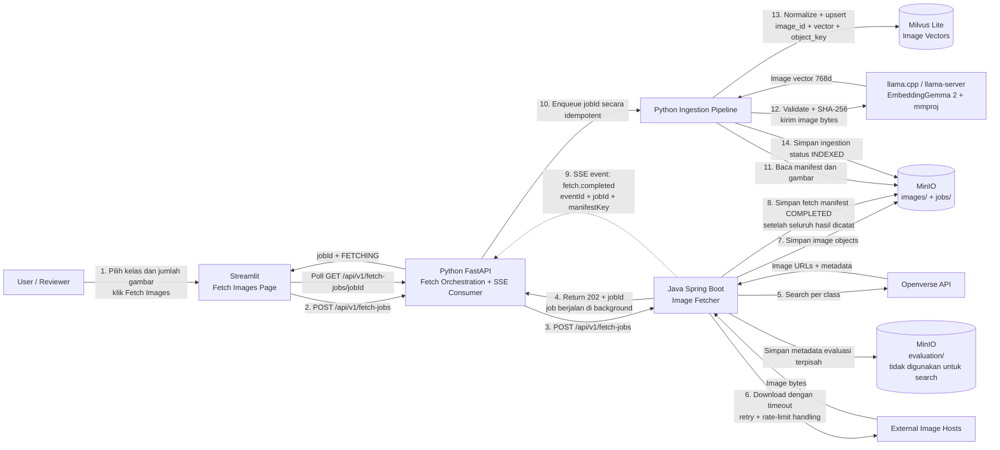
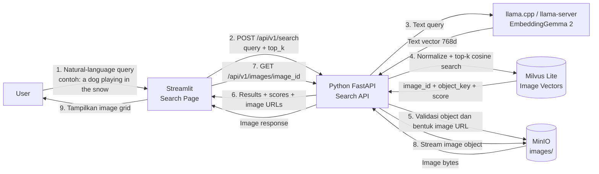

# Rencana Implementasi Mini Image Search - Bank MAS

## 1. Status dan Tujuan Dokumen

Dokumen ini adalah pedoman utama implementasi take-home assignment Machine Learning Engineer Bank MAS. Keputusan arsitektur, kontrak antar-service, struktur data, dan acceptance criteria di dokumen ini harus diikuti selama implementasi. Jika ada perubahan desain, perbarui dokumen ini bersama perubahan kodenya.

Tujuan sistem:

1. Mengambil gambar dari Openverse berdasarkan minimal 20 kelas yang dipilih.
2. Menyimpan gambar sebagai object di MinIO.
3. Membuat image embedding langsung dari piksel gambar menggunakan EmbeddingGemma 2 melalui llama.cpp.
4. Menyimpan embedding di Milvus tanpa duplikat ketika ingestion diulang.
5. Menyediakan pencarian gambar menggunakan natural-language query melalui Streamlit.
6. Menyediakan halaman Streamlit terpisah untuk memicu fetching dan memantau prosesnya.
7. Menggunakan SSE sebagai mekanisme wajib untuk memberi tahu Python bahwa Java telah menyelesaikan fetching dan ingestion dapat dimulai.
8. Tetap dapat memulihkan ingestion jika event SSE terlewat, tanpa menambahkan job database.

## 2. Ruang Lingkup dan Batasan

### 2.1 Komponen wajib dari brief

- Java Spring Boot image fetcher.
- Python ingestion pipeline.
- Milvus sebagai vector database.
- Streamlit sebagai web application.
- Minimal 20 kelas gambar.
- Dataset beberapa ratus gambar sudah cukup.
- Sistem dapat berjalan di laptop tanpa GPU.

### 2.2 Aturan penggunaan data

- Pencarian hanya boleh menggunakan representasi yang dibuat dari piksel gambar.
- Title, tags, deskripsi, dan metadata tekstual Openverse tidak boleh menjadi dasar pencarian.
- Nama kelas yang digunakan saat fetching tidak boleh menjadi dasar pencarian.
- Metadata Openverse boleh disimpan terpisah untuk evaluasi retrieval.
- Metadata evaluasi tidak boleh dibaca oleh ingestion maupun search runtime.
- Openverse tidak dipanggil ketika user melakukan pencarian.

### 2.3 Keputusan operasional

- Fetching tidak berjalan otomatis ketika service dinyalakan.
- Fetching dimulai secara eksplisit dari halaman **Fetch Images** di Streamlit.
- Java menjalankan fetching sebagai background job setelah menerima REST request.
- SSE wajib digunakan sebagai trigger utama ingestion setelah manifest fetching selesai disimpan.
- Manifest di MinIO menjadi sumber kebenaran pekerjaan yang telah selesai di-fetch.
- Reconciliation dan endpoint ingestion manual disediakan sebagai fallback jika SSE terlewat.
- Tidak menggunakan PostgreSQL, Redis, RabbitMQ, atau job database tambahan.
- Tidak menggunakan message queue tambahan untuk MVP.

## 3. Tech Stack

| Komponen | Teknologi |
|---|---|
| Image fetcher | Java, Spring Boot |
| Python service | Python, FastAPI |
| Web application | Streamlit dengan dua halaman |
| Model inference | llama.cpp `llama-server` mode embeddings |
| Embedding model | `unsloth/embeddinggemma-2-GGUF` |
| Model utama | `embeddinggemma-2-UD-Q4_K_XL.gguf` |
| Multimodal projector | `mmproj-Q8_0.gguf` |
| Vector database | Milvus Lite untuk deployment lokal |
| Object storage | MinIO, S3-compatible |
| Container runtime | Podman dan Podman Compose |
| Dependency management Python | uv |

Keputusan model:

- EmbeddingGemma 2 digunakan untuk text dan image embedding dalam vector space yang sama.
- Dimensi native yang digunakan adalah 768.
- File `mmproj` wajib dimuat untuk image embedding.
- Versi llama.cpp harus menyertakan dukungan EmbeddingGemma 2 multimodal embeddings dan versinya dipin agar hasil reprodusibel.
- Konfigurasi model, pooling, normalisasi, dan prompt format harus konsisten antara ingestion dan pencarian.

## 4. Arsitektur High-Level

```text
Streamlit Fetch Images
        |
        v
Python FastAPI -> Java Spring Boot -> Openverse dan image hosts
        |                                  |
        |                                  v
        |                                MinIO
        |                                  |
        |                       fetch manifest COMPLETED
        |                                  |
        +<------- SSE fetch.completed ---- Java
        |
        v
Ingestion Pipeline -> llama.cpp EmbeddingGemma 2 -> Milvus

Streamlit Search -> Python FastAPI -> EmbeddingGemma 2 text vector
                                  -> Milvus top-k search
                                  -> MinIO image objects
                                  -> Streamlit image grid
```

Prinsip pembagian tanggung jawab:

- Java hanya bertanggung jawab atas Openverse, download gambar, penyimpanan awal, job fetching, manifest, dan event fetching.
- Python bertanggung jawab atas orchestration API, SSE consumer, ingestion, embedding, Milvus, pencarian, dan penyediaan gambar hasil pencarian.
- llama.cpp hanya menjadi inference service dan tidak berkomunikasi langsung dengan MinIO atau Milvus.
- Milvus tidak menyimpan title, tags, atau nama kelas Openverse untuk pencarian.
- Streamlit tidak berkomunikasi langsung dengan Openverse, llama.cpp, MinIO, atau Milvus.

## 5. Diagram Fetching dan Ingestion



SSE bersifat wajib untuk trigger otomatis. Fallback tidak menggantikan SSE, tetapi memastikan pekerjaan tetap dapat diproses ketika notifikasi tidak diterima.

## 6. Diagram Pencarian



Pencarian tidak berinteraksi dengan Java atau Openverse.

## 7. Halaman Streamlit

### 7.1 Halaman Fetch Images

Fungsi:

- Menerima daftar kelas yang akan di-fetch.
- Menerima jumlah gambar per kelas.
- Menampilkan konfigurasi Openverse yang aman untuk ditampilkan, tanpa credentials.
- Tombol **Fetch Images** memanggil Python FastAPI.
- Menampilkan `jobId` setelah request diterima.
- Melakukan polling status job secara berkala.
- Menampilkan fase fetching dan ingestion.
- Menampilkan jumlah gambar berhasil, gagal, duplikat, dan berhasil di-index jika tersedia.
- Menampilkan error yang dapat dipahami user.
- Menyediakan tombol **Retry Ingestion** untuk job yang fetching-nya selesai tetapi ingestion gagal atau event SSE terlewat.

State UI minimal:

- belum ada job,
- request sedang dikirim,
- fetching,
- menunggu ingestion,
- ingesting,
- ready/indexed,
- partial failure,
- failed.

### 7.2 Halaman Search

Fungsi:

- Search box untuk natural-language query.
- Pilihan `top_k` dengan batas yang wajar.
- Tombol atau form submit untuk menjalankan pencarian.
- Menampilkan hasil dalam image grid.
- Menampilkan similarity score secara opsional.
- Tidak menampilkan title, tags, atau kelas Openverse sebagai dasar maupun penjelasan hasil pencarian.

State UI minimal:

- initial state sebelum pencarian,
- loading,
- empty result,
- error,
- hasil pencarian.

### 7.3 Navigasi

Gunakan dua halaman eksplisit:

1. **Fetch Images**
2. **Search**

Tidak perlu menambahkan halaman lain untuk MVP.

## 8. Kontrak REST API

Base path dapat disesuaikan saat implementasi, tetapi kontrak dan tanggung jawabnya harus tetap konsisten.

### 8.1 Python API untuk Streamlit

#### Memulai fetching

```http
POST /api/v1/fetch-jobs
Content-Type: application/json

{
  "classes": ["dog", "cat", "bicycle"],
  "imagesPerClass": 20
}
```

Respons:

```http
HTTP/1.1 202 Accepted
```

```json
{
  "jobId": "fetch-20261116-001",
  "status": "FETCHING"
}
```

Python meneruskan request ke Java. Python tidak mengunduh gambar dari Openverse sendiri.

#### Membaca status gabungan

```http
GET /api/v1/fetch-jobs/{jobId}
```

Respons minimal:

```json
{
  "jobId": "fetch-20261116-001",
  "fetchStatus": "COMPLETED",
  "ingestionStatus": "INDEXED",
  "downloaded": 55,
  "failedDownloads": 5,
  "indexed": 54,
  "duplicates": 1,
  "errors": []
}
```

#### Retry ingestion

```http
POST /api/v1/ingest/{jobId}
```

Endpoint ini wajib tersedia untuk recovery. Request untuk job yang sama harus idempotent.

#### Search

```http
POST /api/v1/search
Content-Type: application/json

{
  "query": "a dog playing in the snow",
  "topK": 12
}
```

Respons:

```json
{
  "query": "a dog playing in the snow",
  "results": [
    {
      "imageId": "7ca92f...",
      "score": 0.8123,
      "imageUrl": "/api/v1/images/7ca92f..."
    }
  ]
}
```

#### Mengambil gambar

```http
GET /api/v1/images/{imageId}
```

Python mengambil `object_key` berdasarkan `imageId`, membaca object dari MinIO, lalu mengembalikan image bytes dengan content type yang benar. Pendekatan ini menghindari masalah URL MinIO internal yang tidak dapat diakses browser.

#### Health

```http
GET /health
GET /ready
```

Readiness setidaknya memeriksa koneksi ke Milvus, MinIO, dan llama.cpp. Status SSE consumer juga perlu diekspos untuk observability.

### 8.2 Java API internal

```http
POST /api/v1/fetch-jobs
GET  /api/v1/fetch-jobs/{jobId}
GET  /api/v1/events/fetch
```

`POST /api/v1/fetch-jobs` harus segera mengembalikan `202 Accepted` dan menjalankan pekerjaan di background. Endpoint tidak boleh menunggu seluruh download selesai.

## 9. Kontrak SSE

### 9.1 Koneksi

- Java menjadi SSE server.
- Python menjadi SSE client.
- Python membuka koneksi ke `GET /api/v1/events/fetch` ketika startup.
- Python melakukan reconnect dengan exponential backoff jika koneksi terputus.
- Java mengirim heartbeat atau comment frame secara berkala untuk menjaga koneksi.
- Java hanya mengirim event completion setelah fetch manifest `COMPLETED` berhasil disimpan di MinIO.

### 9.2 Event

```text
id: fetch:fetch-20261116-001:completed
event: fetch.completed
data: {"jobId":"fetch-20261116-001","manifestKey":"jobs/fetch-20261116-001/fetch-manifest.json"}
```

Isi event:

- `eventId` dari SSE `id` untuk logging dan deduplikasi runtime.
- `jobId` untuk identitas pekerjaan.
- `manifestKey` untuk membaca daftar hasil fetching.

SSE tidak membawa image bytes.

### 9.3 Pemrosesan event

Ketika event diterima, Python harus:

1. Memvalidasi payload.
2. Mengabaikan event duplikat yang sedang atau sudah diproses.
3. Menambahkan `jobId` ke ingestion queue in-memory.
4. Membaca manifest langsung dari MinIO.
5. Menjalankan ingestion secara idempotent.
6. Mencatat status ingestion ke MinIO.
7. Mencatat error tanpa menghentikan SSE consumer.

SSE tidak menjamin delivery atau replay. Oleh karena itu, sistem wajib memiliki mekanisme berikut:

- reconciliation saat Python startup,
- reconciliation berkala dengan interval yang dapat dikonfigurasi,
- retry melalui `POST /api/v1/ingest/{jobId}`,
- idempotent ingestion untuk setiap gambar.

## 10. Struktur Object di MinIO

Gunakan satu bucket aplikasi dengan prefix yang jelas:

```text
images/
  {sha256}.{extension}

evaluation/
  {imageId}.json

jobs/
  {jobId}/
    fetch-manifest.json
    ingestion-status.json
```

### 10.1 Image objects

- Object key menggunakan hash isi file, bukan judul atau nama kelas.
- Ekstensi ditentukan setelah validasi format gambar.
- File yang identik memiliki object key yang sama.
- Metadata pencarian tidak disematkan ke object key.

### 10.2 Evaluation metadata

Metadata Openverse disimpan hanya di `evaluation/`, misalnya:

```json
{
  "imageId": "7ca92f...",
  "requestedClass": "dog",
  "title": "Openverse title",
  "tags": ["dog", "animal"],
  "sourceUrl": "https://...",
  "license": "...",
  "creator": "..."
}
```

File ini hanya boleh dibaca oleh script evaluasi. Ingestion dan search dilarang membaca prefix ini.

### 10.3 Fetch manifest

Java menulis manifest final setelah proses fetching selesai:

```json
{
  "jobId": "fetch-20261116-001",
  "status": "COMPLETED",
  "requestedClasses": ["dog", "cat", "bicycle"],
  "images": [
    {
      "imageId": "7ca92f...",
      "objectKey": "images/7ca92f.jpg",
      "contentType": "image/jpeg",
      "sha256": "7ca92f..."
    }
  ],
  "failedDownloads": [
    {
      "requestedClass": "cat",
      "url": "https://...",
      "reason": "timeout"
    }
  ],
  "startedAt": "...",
  "completedAt": "..."
}
```

Jika fetching gagal total, gunakan status `FAILED` dan jangan kirim `fetch.completed`. Kegagalan sebagian tetap dapat menghasilkan `COMPLETED` dengan daftar `failedDownloads`, selama terdapat hasil yang dapat diproses. Status `PARTIAL` boleh digunakan jika lebih memperjelas implementasi, tetapi harus konsisten di Java, Python, dan UI.

### 10.4 Ingestion status

Python menulis status berikut:

```json
{
  "jobId": "fetch-20261116-001",
  "status": "INDEXED",
  "totalImages": 55,
  "indexed": 54,
  "duplicates": 1,
  "failed": 0,
  "errors": [],
  "startedAt": "...",
  "completedAt": "..."
}
```

Status yang didukung:

- `PENDING`
- `INGESTING`
- `INDEXED`
- `FAILED`

Transient progress sebelum manifest tersedia boleh disimpan in-memory. Manifest dan ingestion status di MinIO adalah catatan persisten. Restart boleh menghilangkan progress runtime, tetapi tidak boleh menyebabkan duplikasi atau kehilangan kemampuan retry.

## 11. Ingestion Pipeline

Urutan untuk setiap gambar:

1. Baca `fetch-manifest.json` berdasarkan `jobId` atau `manifestKey`.
2. Ambil image object dari MinIO.
3. Validasi bahwa object dapat didekode sebagai gambar.
4. Hitung SHA-256 dari image bytes dan cocokkan dengan manifest.
5. Bentuk `image_id` deterministik dari SHA-256.
6. Kirim image bytes ke llama.cpp embeddings endpoint menggunakan format multimodal yang benar.
7. Validasi respons berisi vector berdimensi 768 dan nilai numerik yang valid.
8. Lakukan L2 normalization jika menggunakan cosine similarity.
9. Upsert ke Milvus menggunakan primary key `image_id`.
10. Catat kegagalan per gambar tanpa menghentikan seluruh job.
11. Simpan `ingestion-status.json` setelah seluruh gambar selesai atau gagal diproses.

Pengaturan resource:

- Satu ingestion worker untuk MVP.
- Batch kecil, default 1 sampai 4 gambar.
- Tidak menjalankan inference banyak gambar secara paralel secara default.
- Event atau retry untuk job yang sama tidak boleh membuat dua worker memproses job yang sama secara bersamaan.
- Retry aman karena menggunakan upsert dan ID deterministik.

## 12. Integrasi llama.cpp

### 12.1 Model

- Main model: `embeddinggemma-2-UD-Q4_K_XL.gguf`.
- Multimodal projector: `mmproj-Q8_0.gguf`.
- Server dijalankan dengan embeddings mode dan `--mmproj`.
- Model dan projector tidak di-commit ke Git.
- Dokumentasikan cara download dan checksum atau revisi sumber model.

### 12.2 Image embedding

Gunakan `POST /v1/embeddings` dengan typed content parts yang benar:

```json
{
  "model": "embeddinggemma-2",
  "input": [
    {
      "content": [
        {
          "type": "image_url",
          "image_url": {
            "url": "data:image/jpeg;base64,BASE64_IMAGE_BYTES"
          }
        }
      ]
    }
  ]
}
```

Jangan menggunakan endpoint lama atau field request yang belum terverifikasi. Jangan mengirim title, tags, nama kelas, atau caption Openverse bersama gambar.

### 12.3 Text embedding

Query user dikirim ke model yang sama melalui embeddings endpoint. Konfigurasi prompt atau task prefix harus mengikuti model card dan dibuat konsisten serta terdokumentasi.

### 12.4 Smoke test wajib

Sebelum ingestion penuh:

1. Embed dua gambar yang sangat berbeda.
2. Pastikan kedua vector tidak identik.
3. Pastikan dimensinya 768 dan tidak mengandung NaN atau infinity.
4. Buat text embedding untuk deskripsi salah satu gambar.
5. Pastikan gambar yang relevan mendapat ranking lebih baik daripada gambar yang tidak relevan.
6. Simpan hasil smoke test sebagai bagian pengujian integrasi lokal, bukan sebagai klaim benchmark performa.

## 13. Skema Milvus

Collection: `image_embeddings`

| Field | Tipe | Keterangan |
|---|---|---|
| `image_id` | VARCHAR, primary key | SHA-256 hex, panjang tetap 64 |
| `embedding` | FLOAT_VECTOR, dim=768 | Embedding ternormalisasi |
| `object_key` | VARCHAR | Lokasi gambar di MinIO |
| `content_type` | VARCHAR | MIME type gambar |
| `created_at` | INT64 | Unix timestamp ingestion pertama |

Aturan:

- Tidak ada field `title`, `tags`, `requested_class`, atau `description` dari Openverse.
- Metric: `COSINE`.
- Untuk dataset kecil, gunakan index sederhana yang didukung Milvus Lite, misalnya `FLAT`, agar tidak membutuhkan proses training index.
- Query search menggunakan `top_k` yang divalidasi.
- Output search hanya mengambil `image_id`, `object_key`, `content_type`, dan score.
- Upsert dengan `image_id` yang sama tidak boleh menambah row baru.

## 14. Penanganan Openverse dan Download

Java harus menangani:

- request timeout,
- connection error,
- HTTP 429 dan `Retry-After` jika tersedia,
- rate limit dengan request pacing yang dapat dikonfigurasi,
- retry dengan exponential backoff dan jitter,
- batas jumlah retry,
- URL rusak atau tidak dapat diakses,
- response bukan gambar,
- gambar yang tidak dapat didekode,
- ukuran file melebihi batas,
- duplikat gambar,
- kegagalan sebagian tanpa menggagalkan seluruh job.

Kelas awal harus dipilih secara visual berbeda. Contoh kandidat:

```text
dog, cat, elephant, bicycle, car, airplane, pizza, chair,
tree, flower, building, bridge, boat, train, bird, horse,
cake, laptop, guitar, mountain
```

Daftar final dan jumlah gambar per kelas harus dicatat di README setelah ingestion. Openverse credentials, jika digunakan, dibaca dari environment dan tidak di-commit.

## 15. Reconciliation dan Recovery

Reconciliation tidak menggantikan SSE. SSE tetap menjadi trigger utama dengan latensi rendah.

Python harus dapat:

1. Memindai `jobs/*/fetch-manifest.json` saat startup.
2. Memindai manifest secara berkala dengan interval konfigurabel.
3. Membandingkan fetch manifest dengan `ingestion-status.json`.
4. Memproses manifest yang belum memiliki status `INDEXED`.
5. Memproses ulang status `FAILED` berdasarkan konfigurasi retry atau request manual.
6. Menghindari job yang sama diproses dua kali secara bersamaan.
7. Mengandalkan `image_id` dan upsert untuk membersihkan efek retry.

Skenario yang harus lulus:

- Python mati ketika Java mengirim SSE, lalu Python dinyalakan kembali.
- SSE diterima dua kali.
- Python gagal di tengah ingestion lalu job diulang.
- Ingestion dijalankan ulang setelah berhasil.
- Sebagian gambar gagal di-embed.
- Java restart ketika ada job berjalan. Keterbatasan status job in-memory harus dicatat dengan jelas di README.

## 16. Struktur Proyek yang Disarankan

```text
.
├── fetcher/                    # Java Spring Boot
│   ├── src/
│   └── pom.xml
├── backend/                    # FastAPI, SSE consumer, ingestion, search
│   ├── app/
│   │   ├── api/
│   │   ├── ingestion/
│   │   ├── integrations/
│   │   ├── models/
│   │   └── main.py
│   ├── tests/
│   └── pyproject.toml
├── frontend/                   # Streamlit
│   ├── app.py
│   ├── views/
│   │   ├── fetch_images.py
│   │   └── search.py
│   └── pyproject.toml
├── scripts/
│   ├── download_models.sh
│   ├── smoke_test_embeddings.py
│   └── evaluate_retrieval.py
├── deploy/
│   ├── compose.yaml
│   └── Containerfile.*
├── models/                     # GGUF lokal, di-ignore Git
├── data/                       # Milvus Lite dan data lokal, di-ignore Git
├── docs/
│   └── rencana-implementasi.md
├── .env.example
├── .gitignore
└── README.md
```

Struktur boleh disesuaikan dengan kebutuhan implementasi, tetapi pemisahan tanggung jawab harus dipertahankan.

## 17. Tahapan Implementasi

### Fase 1: Skeleton dan konfigurasi

- Buat struktur proyek.
- Siapkan `.env.example` dan `.gitignore`.
- Siapkan MinIO dan bucket aplikasi.
- Siapkan Milvus Lite.
- Pin versi dependency dan llama.cpp.

Acceptance criteria:

- Semua konfigurasi dapat dibaca dari environment.
- Credentials dan model tidak masuk Git.
- MinIO dapat diakses oleh Java dan Python.

### Fase 2: Model smoke test

- Download GGUF dan mmproj.
- Jalankan llama.cpp embeddings server.
- Implementasikan text dan image embedding client.
- Jalankan smoke test pada bagian integrasi llama.cpp.

Acceptance criteria:

- Image dan text embedding berdimensi 768.
- Dua gambar berbeda tidak menghasilkan vector identik.
- Cross-modal retrieval kecil menghasilkan ranking yang masuk akal.

### Fase 3: Java fetcher

- Implementasikan `POST /api/v1/fetch-jobs`.
- Implementasikan background fetching dan status endpoint.
- Implementasikan Openverse client, downloader, retry, dan rate-limit handling.
- Simpan gambar ke `images/`.
- Simpan metadata ke `evaluation/`.
- Tulis fetch manifest.

Acceptance criteria:

- Tombol atau REST request dapat memulai background job.
- File yang tersimpan dapat didekode sebagai gambar.
- Kegagalan download tercatat.
- Manifest hanya dibuat setelah proses fetching selesai.

### Fase 4: SSE dan orchestration

- Implementasikan Java SSE endpoint.
- Implementasikan Python SSE consumer dengan reconnect.
- Implementasikan Python fetch proxy dan aggregated status endpoint.
- Implementasikan ingestion queue in-memory dan deduplikasi job runtime.

Acceptance criteria:

- Java mengirim event hanya setelah manifest tersedia.
- Python menerima event dan memulai ingestion tanpa interaksi user tambahan.
- Event duplikat tidak membuat ingestion paralel untuk job yang sama.

### Fase 5: Milvus ingestion

- Buat collection dan schema.
- Implementasikan idempotent upsert.
- Implementasikan ingestion status di MinIO.
- Implementasikan retry manual dan reconciliation.

Acceptance criteria:

- Menjalankan ingestion dua kali tidak menambah duplikat.
- Event SSE yang terlewat dapat dipulihkan.
- Python restart tidak menghilangkan catatan manifest dan status.

### Fase 6: Search API

- Implementasikan text embedding query.
- Implementasikan Milvus top-k search.
- Implementasikan image streaming endpoint.
- Tambahkan validasi query, top_k, dan error handling.

Acceptance criteria:

- Query natural language mengembalikan gambar dari koleksi lokal.
- Tidak ada request ke Openverse saat search.
- Tidak ada penggunaan metadata Openverse dalam search.

### Fase 7: Streamlit dua halaman

- Buat halaman Fetch Images.
- Buat halaman Search.
- Tambahkan polling status fetch dan ingestion.
- Tambahkan tombol Retry Ingestion.
- Tambahkan loading, empty, error, dan success state.

Acceptance criteria:

- User dapat memulai fetching dari UI.
- Ingestion berjalan otomatis melalui SSE setelah fetching selesai.
- User dapat melihat status sampai `INDEXED`.
- User dapat mencari dan melihat image grid.

### Fase 8: Containerization dan dokumentasi

- Siapkan `deploy/compose.yaml` yang kompatibel dengan Podman Compose.
- Gunakan Milvus Lite untuk mengurangi jumlah service dan resource.
- Sediakan satu perintah startup setelah model dan environment disiapkan.
- Tulis README setup dari fresh machine.
- Dokumentasikan arsitektur, model, kelas, jumlah gambar, query contoh, screenshot, limitations, dan rencana peningkatan.

Acceptance criteria:

- Reviewer dapat menjalankan sistem dengan mengikuti README.
- Tidak ada credentials di repository.
- Sistem berjalan tanpa GPU.

## 18. Strategi Testing

### 18.1 Unit test Java

- Validasi request kelas dan jumlah gambar.
- Openverse response parsing.
- Retry, timeout, dan HTTP 429 dengan mocked client.
- Validasi content type dan image decode.
- Penentuan object key dan hash.
- Pembuatan fetch manifest.
- Event completion tidak dikirim sebelum manifest berhasil disimpan.

### 18.2 Unit test Python

- Parsing dan validasi SSE event.
- Deduplikasi event dan job.
- Manifest parsing.
- Validasi embedding response.
- L2 normalization.
- Deterministic ID dan idempotent ingestion.
- Search query validation.
- Reconciliation terhadap berbagai kombinasi status manifest.
- Metadata evaluasi tidak pernah menjadi input embedding atau filter search.

### 18.3 Integration test

Gunakan mocked Openverse untuk test deterministik. Test dengan Openverse sungguhan dibuat terpisah dan tidak menjadi syarat setiap unit-test run.

Skenario integrasi minimal:

1. Fetch kecil untuk dua kelas.
2. Manifest tersimpan.
3. SSE diterima Python.
4. Image embedding masuk Milvus.
5. Search mengembalikan hasil.
6. Re-ingestion tidak membuat duplikat.
7. Python restart setelah event terlewat tetap dapat memproses manifest melalui reconciliation.

### 18.4 Evaluasi retrieval bonus

- Gunakan metadata di `evaluation/` hanya pada script evaluasi.
- Hitung metric sederhana seperti precision@k per kelas.
- Jangan membawa metadata evaluasi ke search runtime.
- Laporkan konfigurasi query dan keterbatasan ground truth karena metadata Openverse dapat tidak lengkap atau tidak akurat.

## 19. Resource dan Operasional Laptop

- Target utama: CPU tanpa GPU.
- Gunakan dataset beberapa ratus gambar.
- Gunakan satu ingestion worker dan batch kecil.
- Gunakan Milvus Lite untuk mengurangi overhead service.
- Model Q4 dan mmproj Q8 memiliki total file bobot sekitar 731 MB, belum termasuk runtime memory.
- RAM 8 GB realistis untuk dicoba dengan concurrency rendah; RAM 16 GB lebih nyaman. Ini pedoman praktis, bukan hasil benchmark proyek.
- Jangan menyalakan fetching Openverse otomatis saat startup.
- Jangan menjalankan beberapa llama.cpp server.
- Gunakan timeout dan batas ukuran image agar object bermasalah tidak menghabiskan resource.

## 20. Definition of Done

Sistem dianggap selesai jika seluruh poin berikut terpenuhi:

- [ ] Minimal 20 kelas dapat di-fetch melalui tombol di Streamlit.
- [ ] Java menjalankan fetching sebagai background job.
- [ ] Java menyimpan gambar dan fetch manifest di MinIO.
- [ ] Java mengirim SSE `fetch.completed` setelah manifest tersedia.
- [ ] Python menerima SSE dan otomatis menjalankan ingestion.
- [ ] Reconciliation dan retry manual tersedia untuk event yang terlewat atau ingestion yang gagal.
- [ ] Embedding dibuat hanya dari piksel gambar dan query user.
- [ ] Milvus menyimpan image vector dan metadata teknis, bukan metadata pencarian Openverse.
- [ ] Re-ingestion tidak membuat duplikat.
- [ ] Halaman Search menampilkan image grid berdasarkan natural-language query.
- [ ] Search tidak memanggil Openverse.
- [ ] Unit test untuk core logic tersedia dan lulus.
- [ ] Smoke test multimodal embedding berhasil.
- [ ] Sistem berjalan di laptop tanpa GPU.
- [ ] README berisi setup fresh machine, arsitektur, keputusan desain, daftar kelas, jumlah gambar, query contoh, screenshot, dan limitations.
- [ ] Tidak ada credentials atau model besar yang di-commit.

## 21. Known Limitations yang Harus Dipertimbangkan

- SSE tidak memberikan durable event delivery; manifest dan reconciliation menutup kelemahan ini.
- In-memory runtime status dapat hilang saat service restart, sedangkan manifest dan ingestion status tetap tersedia di MinIO.
- Metadata Openverse belum tentu akurat sebagai ground truth evaluasi.
- Quantization dapat menurunkan kualitas embedding dibandingkan model presisi penuh.
- Model yang lebih besar dari CLIP kecil dapat membuat ingestion CPU lebih lambat.
- Hasil zero-shot image retrieval dapat kurang baik untuk konsep yang sangat spesifik atau ambigu.
- Milvus Lite dan single ingestion worker ditujukan untuk skala assignment, bukan production throughput tinggi.
